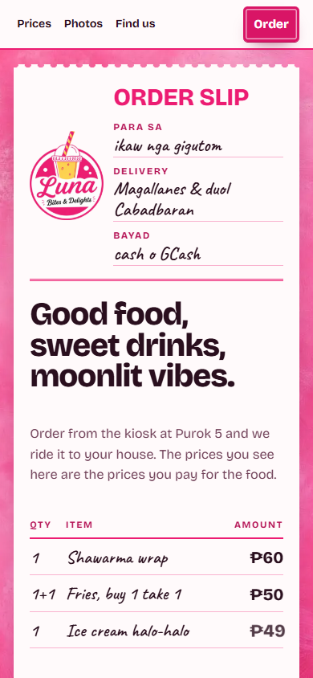
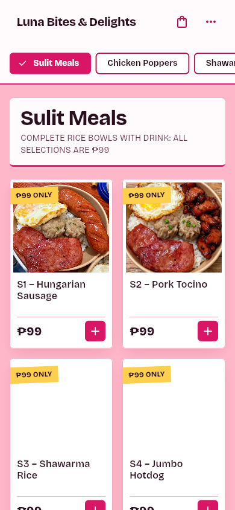

# Hosting migration — Luna Express → Luna Bites & Delights

## What changed

The business now has one canonical address. `lunaexpress.web.app` is no longer a
site; it is a permanent redirect.

| Concern | Before | After |
| :--- | :--- | :--- |
| Canonical domain | `lunaexpress.web.app` | `lunabitesanddelights.web.app` |
| Legacy domain | Served the old storefront | 301 → canonical domain |
| Firebase Hosting config | One `hosting` object bound to the `app-site` target, which covered both sites | `hosting` array: `app-site` target → canonical site; `site: lunaexpress` → redirect-only config |
| Canonical / `og:url` / JSON-LD `@id`, `url`, `hasMenu` | `lunaexpress.web.app` | `lunabitesanddelights.web.app` |
| `robots.txt` sitemap pointer | `lunaexpress.web.app/sitemap.xml` | `lunabitesanddelights.web.app/sitemap.xml` |
| `sitemap.xml` entries | `lunaexpress.web.app` | `lunabitesanddelights.web.app` |
| `llms.txt` ordering/storefront URLs | `lunaexpress.web.app` | `lunabitesanddelights.web.app` |
| PayMongo `success_url` / `cancel_url` | `lunaexpress.web.app/payment/*` | `lunabitesanddelights.web.app/payment/*` |
| GCash WebView host allowlist | `lunaexpress.*` only | `lunabitesanddelights.*` + `lunaexpress.*` |
| App display names (`web/manifest.json`, iOS, Android) | `Luna Express` | `Luna Bites & Delights` |
| CI live deploy | Deployed the single site | Deploys the canonical site, then the legacy redirect site |
| `deploy.sh` / `deploy.bat` | `flutter build web` with no base href and no storefront assembly, then `deploy --only hosting` | `--base-href /kiosk/` + `dart run tool/assemble_site.dart`, then deploy |

### Redirect rules (`firebase.json`, legacy site entry)

```json
{
  "site": "lunaexpress",
  "public": "legacy-redirect",
  "redirects": [
    { "source": "/kiosk{,/**}", "destination": "https://lunabitesanddelights.web.app/kiosk/", "type": 301 },
    { "source": "/**", "destination": "https://lunabitesanddelights.web.app/", "type": 301 }
  ]
}
```

`/kiosk` and `/kiosk/**` keep their destination path so a shared ordering link
still lands on the app. The app is hash-routed, so `#/menu`, `#/cart` and the
rest survive the redirect untouched. Everything else goes to the canonical root.

Firebase Hosting does not substitute `:path` inside a redirect `destination`
(a `:path` destination silently disables the rule — verified by deploying it and
observing a 200 instead of a 301), so the two explicit rules above are used
instead of one path-preserving catch-all.

### Why `lunaexpress` still appears in code

`lunaexpress` is the immutable Google Cloud / Firebase **project ID**. It stays in
`lib/firebase_options.dart` (`projectId`, `authDomain`, `storageBucket`), the
`--project lunaexpress` flags, the service-account secret name, and the emulator
project ID. Changing those would break Authentication, Firestore, Storage and
Functions. Only the *public hostname* moved.

## Proof

Full captured output: [`hosting-migration-proof.txt`](hosting-migration-proof.txt).

### Legacy domain redirects

```text
/                      HTTP/1.1 301 Moved Permanently Location: https://lunabitesanddelights.web.app/
/kiosk/                HTTP/1.1 301 Moved Permanently Location: https://lunabitesanddelights.web.app/kiosk/
/kiosk                 HTTP/1.1 301 Moved Permanently Location: https://lunabitesanddelights.web.app/kiosk/
/images/og-cover.jpg   HTTP/1.1 301 Moved Permanently Location: https://lunabitesanddelights.web.app/
/llms.txt              HTTP/1.1 301 Moved Permanently Location: https://lunabitesanddelights.web.app/
/sitemap.xml           HTTP/1.1 301 Moved Permanently Location: https://lunabitesanddelights.web.app/
```

### Redirect chain resolves

```text
/          final=https://lunabitesanddelights.web.app/ status=200
/kiosk/    final=https://lunabitesanddelights.web.app/kiosk/ status=200
```

### Canonical domain serves the migrated build

```text
title:     <title>Luna Bites &amp; Delights — Food Kiosk &amp; Delivery in Magallanes, near Cabadbaran</title>
canonical: rel="canonical" href="https://lunabitesanddelights.web.app/"
og:url:    property="og:url" content="https://lunabitesanddelights.web.app/"
```

### Route availability on the canonical domain

```text
/                            200
/robots.txt                  200
/sitemap.xml                 200
/llms.txt                    200
/kiosk/                      200
/kiosk/manifest.json         200
/images/og-cover.jpg         200
/img/luna-logo-640.webp      200
```

### Browser check

Opening `https://lunaexpress.web.app/` in a real browser lands on
`https://lunabitesanddelights.web.app/` (URL read back from the live page).



The ordering app on the canonical domain renders the menu:



### Local checks

```text
flutter test                          37/37 passed
flutter analyze (baseline gate)       87 issues (baseline 87)
functions npm run build               clean
functions npm test                    16/16 passed
```

## Risks and limits

- **In-flight PayMongo sessions.** A checkout session created before this deploy
  carries the old `success_url`. The GCash WebView intercepts `payment/success`
  before navigation, so those orders still resolve; the redirect never fires.
- **Old-domain assets stop being served directly.** Anything hot-linking an image
  from `lunaexpress.web.app` now receives a 301 to the canonical root rather than
  the image. Nothing in the repo does this; the storefront and kiosk use
  root-relative paths.
- **`robots.txt` on the legacy domain** redirects to the canonical root, so a
  crawler asking the old domain for it gets HTML. Google treats that as "no
  robots.txt", which is permissive, and the canonical domain's `robots.txt` and
  `sitemap.xml` are correct. No crawl blocking results.
- **Custom domain not set up.** The canonical address is still a `web.app`
  subdomain. A branded domain (`lunabitesanddelights.ph`) needs a registrar and
  DNS records, which are outside this repo.

## Rollback

Redeploy the previous release from the Firebase console for `lunaexpress`, or
restore the `hosting` object to a single `app-site` entry bound to both sites and
deploy.
