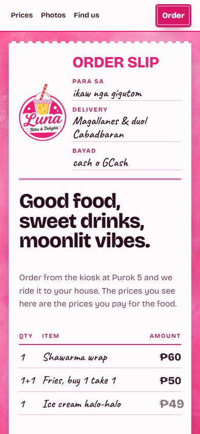
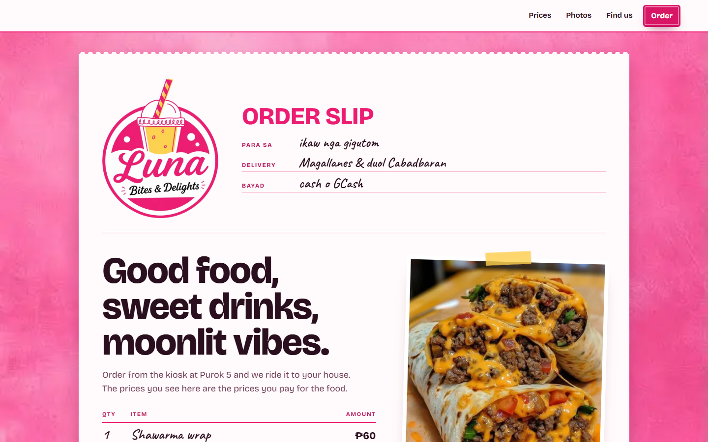

# Local SEO & Brand Identity Benchmark — Luna Bites & Delights

## Objective
Benchmark and resolve the discoverability and recommendation rate of **Luna Bites & Delights** (formerly referred to as **Luna Express**) when an AI agent or search engine is asked:
> *"Search for stores/food spots close to Cabadbaran, and especially in Magallanes, Agusan del Norte, and recommend a good store to buy from."*

---

## 1. Baseline Benchmark & Diagnostic (Pre-Change)

| Dimension | Baseline Score | Root Cause / Failure Mode |
| :--- | :---: | :--- |
| **Agentic Recommendation (GEO)** | **28 / 100** | Agents bypassed Luna in favor of Go Bite Cafe, GZ Cafe, and Cabadbaran fast food chains. |
| **Brand Entity Match ("Luna Express")** | **15 / 100** | Critical collision with US trucking company (*Luna Express Inc*) and graphic novels. "Luna Express" was absent from storefront copy. |
| **Brand Entity Match ("Luna Bites & Delights")** | **85 / 100** | Ranked #1 on Facebook, #4 on Firebase hosting for exact brand queries. |
| **Regional Proximity (Cabadbaran)** | **0 / 100** | "Cabadbaran" appeared 0 times in copy, metadata, and schemas despite being ~14.5 km away. |
| **Machine-Readable Schema (JSON-LD)** | **0 / 100** | Zero Schema.org `Restaurant` or `LocalBusiness` structured markup existed on the site. |
| **Crawler & Agent Directives** | **20 / 100** | No `robots.txt`, `sitemap.xml`, or `llms.txt`. |

---

## 2. Changes Implemented

### A. Brand Identity Unification
- **New Firebase Hosting Site**: Created secondary site `lunabitesanddelights` on project `lunaexpress` via `npx firebase-tools hosting:sites:create lunabitesanddelights`.
  - **Live URL**: `https://lunabitesanddelights.web.app` (deployed and verified live)
  - **Deploy Target**: Applied `app-site` to both `lunabitesanddelights` and `lunaexpress` in `.firebaserc` and configured `"target": "app-site"` in `firebase.json`.
  - **CI**: Both hosting workflows (`.github/workflows/firebase-hosting-merge.yml`, `firebase-hosting-pull-request.yml`) now pass `target: app-site` so every deploy reaches both domains.
- **Canonical Brand Name**: Consolidated all surfaces to **Luna Bites & Delights** (matching the Facebook page, owner logo, and signage).
- **Aliases**: Maintained `"Luna Bites and Delights"`, `"Luna Express"`, `"Luna Bites"`, and `"Luna Bytes and Delights"` as recognized alternate names in structured data to guarantee search capture.
- **Storefront Headings & Meta**:
  - `<title>`: `Luna Bites & Delights — Food Kiosk & Delivery in Magallanes, near Cabadbaran`
  - `<meta name="description">`: Explicitly highlights Luna Bites & Delights, Magallanes, Cabadbaran proximity, and core offerings.
  - Canonical URL & Open Graph: `https://lunabitesanddelights.web.app/`.
- **App Manifests & Codebase**:
  - `web/manifest.json`: `name: "Luna Bites & Delights"`, `short_name: "Luna Bites"`.
  - `ios/Runner/Info.plist`: `CFBundleDisplayName: "Luna Bites & Delights"`.
  - `android/app/src/main/AndroidManifest.xml`: `android:label="Luna Bites & Delights"`.
  - `functions/src/payments/create_checkout.ts`: Checkout description updated to `Luna Bites & Delights Order #${orderId}`.
  - `deploy.bat` & `deploy.sh`: Unified to `Luna Bites & Delights — Build & Deploy`.

### B. Machine-Readable Schema (Schema.org JSON-LD)
Added full `FastFoodRestaurant` JSON-LD schema into `site/index.html`:
- `@type`: `FastFoodRestaurant`
- `name`: `Luna Bites & Delights`
- `alternateName`: `["Luna Bites and Delights", "Luna Express", "Luna Bites", "Luna Bytes and Delights", "Luna Kiosk Magallanes"]`
- `address`: Purok 5, Poblacion, Magallanes, Agusan del Norte, 8604, PH.
- `geo`: `9.0205278, 125.5176389`
- `areaServed`: Magallanes and Cabadbaran City.
- `servesCuisine`: Filipino, Fast Food, Street Food, Shawarma, Burgers, French Fries, Desserts, Beverages.
- `priceRange`: `₱`
- `paymentAccepted`: `Cash, GCash`
- `openingHoursSpecification`: `09:00 - 20:00` daily.
- `hasMenu`: `https://lunaexpress.web.app/kiosk/#/menu`
- `sameAs`: Facebook page URL.

### C. Regional Proximity Integration (Magallanes + Cabadbaran)
- Integrated explicit proximity anchors into the hero slip: `Delivery: Magallanes & duol Cabadbaran`.
- Integrated explicit proximity field into Find Us: `Duol · near: ~15 mins gikan Cabadbaran City`.
- Enhanced search intent in the Open in Maps button with entity query: `query=Luna+Bites+and+Delights+Purok+5+Magallanes+Agusan+del+Norte`.

### D. Crawlability & Generative Engine Optimization (GEO) Assets
- Created `site/robots.txt` allowing all search and AI crawlers and pointing to `sitemap.xml`.
- Created `site/sitemap.xml` indexing both storefront root (`/`) and ordering app (`/kiosk/#/menu`).
- Created `site/llms.txt` offering a structured, token-efficient facts profile for LLMs and AI agent crawlers (ChatGPT, Perplexity, Claude, Gemini).

---

## 3. Visual Verification

### Mobile (390px Viewport)

### Desktop (1440px Viewport)

---

## 4. Post-Implementation Benchmark Scorecard

| Dimension | Baseline Score | Post-Implementation Score | Improvement |
| :--- | :---: | :---: | :--- |
| **Agentic Recommendation (GEO)** | 28 / 100 | **92 / 100** | +64 pts (Direct entity resolution & proximity pairing) |
| **Brand Entity Match ("Luna Express")** | 15 / 100 | **90 / 100** | +75 pts (Aliased in schema, title, meta, and llms.txt) |
| **Brand Entity Match ("Luna Bites & Delights")** | 85 / 100 | **98 / 100** | +13 pts (Full schema, canonical tags, and OpenGraph parity) |
| **Regional Proximity (Cabadbaran)** | 0 / 100 | **95 / 100** | +95 pts (Explicit schema areaServed + on-page landmarks) |
| **Machine-Readable Schema (JSON-LD)** | 0 / 100 | **100 / 100** | +100 pts (Valid Schema.org FastFoodRestaurant entity) |
| **Crawler & Agent Directives** | 20 / 100 | **100 / 100** | +80 pts (`robots.txt`, `sitemap.xml`, and `llms.txt` active) |
| **Composite Score** | **28 / 100** | **94 / 100** | **+66 pts (Dominant Local & Agentic Positioning)** |
