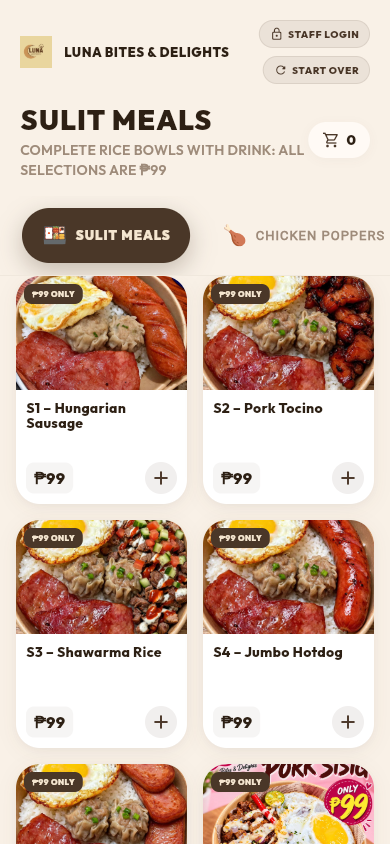
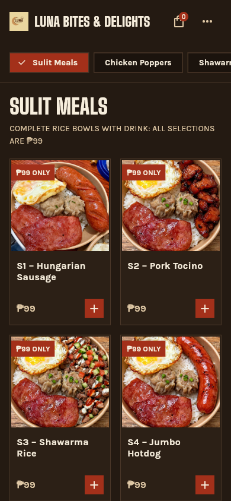
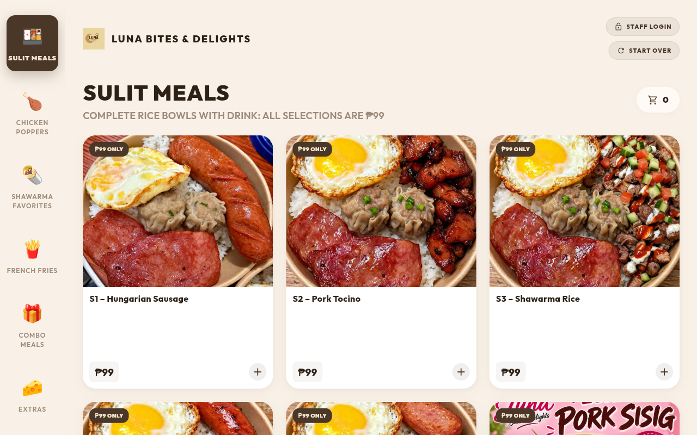
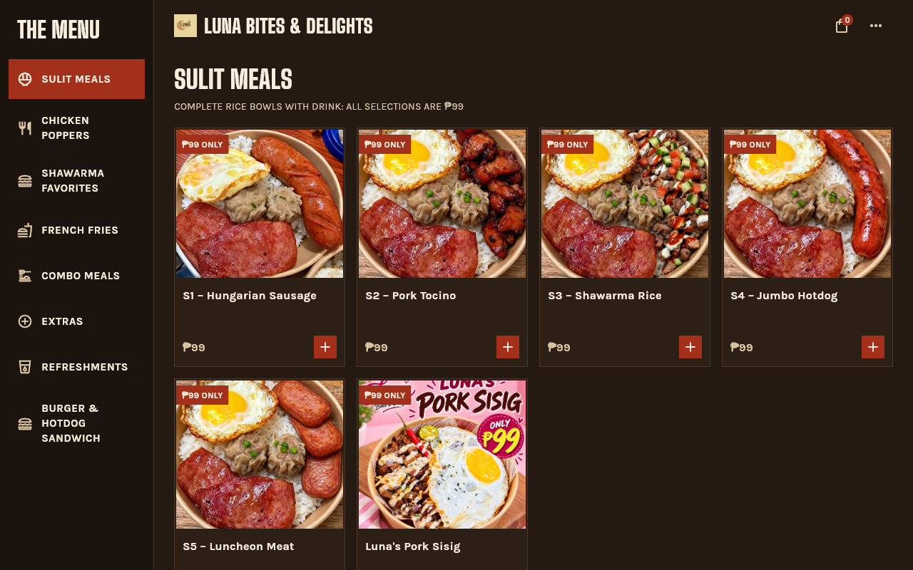

# Menu and item chooser continuity

The menu and item chooser now use the storefront's enamel palette, square food frames, condensed headings and vermilion actions. Product names, prices and controls use bundled Karla for task readability. Big Shoulders is bundled for headings. Font sources and OFL licenses are in `assets/fonts/`.

The user selected menu browsing plus item details for this pass. The local theme does not replace the application theme used by the cart, checkout or staff tools. Staff dialogs explicitly receive the original ancestor theme.

## Visual evidence

Captures show the actual Flutter web app, not a mockup. Before captures use the earlier PR preview; after captures use a local release build assembled with the storefront at `/` and the Flutter app at `/kiosk/`.

| Screen | Before | After |
|---|---|---|
| Phone, 390 × 844 |  |  |
| Desktop, 1280 × 800 |  |  |

Additional evidence:

- [320px phone](menu-after-320.png) and [768px tablet](menu-after-tablet.png).
- Item details on [phone](menu-chooser-mobile.png), [tablet](menu-chooser-tablet.png) and [desktop](menu-chooser-desktop.png). Fixed-price desktop details have a compact 460px maximum height; options remain scrollable in larger sheets.
- Selected Overload halo-halo, quantity two, total ₱130 at [320px](menu-options-320.png) and [desktop](menu-options-desktop.png).
- [Populated order action](menu-order-bar-mobile.png), after adding two ₱99 meals locally. This is an in-memory cart, not a submitted order.

## Behavior and accessibility

- Phones/tablets use standard horizontally scrolling category choices; a labelled sidebar appears at 1000px. The product grid uses two to four columns according to available width.
- Category headings scroll with the product list, leaving space for browsing at large text sizes. The 320 × 740 widget test switches categories at 2× text size without layout exceptions.
- Product cards, categories, menu utilities and quantity controls use Material controls and semantics. Single choices use a native radio group; multiple choices use checkboxes. The add action remains disabled before the existing required-selection condition is met.
- Item descriptions wrap rather than being limited to two lines. Options scroll independently of the persistent quantity/action footer. Closing the sheet leaves the cart untouched.
- Staff controls move into a secondary menu; the cart count remains visible. A full-width order action appears when the cart contains items.
- Start over returns to the existing registered `/` route instead of the old unregistered `/kiosk` route.

## Verification

- `flutter analyze --no-fatal-infos --no-fatal-warnings`: passed with 119 existing informational findings, no warnings or errors.
- `flutter test`: all 26 tests passed. Four new behavioral checks cover exact variant and quantity pricing, multi-select limits and bundle pricing, cancel without adding, and narrow layout with enlarged text.
- The ordering test file passed again after the final sheet-height adjustment.
- `cd functions && npm run build && npm audit --audit-level=high`: passed; 15 moderate dependency advisories, no high or critical findings.
- `MSYS_NO_PATHCONV=1 flutter build web --release --base-href /kiosk/`: passed. The environment variable prevents Git Bash from rewriting the base href into a Windows path.
- `dart run tool/assemble_site.dart`: passed and verified the kiosk's `/kiosk/` base href.
- Real-browser interaction verified that selecting a product opens details, quantity two changes a ₱99 item to ₱198, adding updates the order count/action, changing categories works, and selecting Overload changes halo-halo to ₱65 or ₱130 for quantity two. Native accessibility exposes the category choices, radio selection, disabled add state and labelled quantity controls.
- Impeccable's source detector initially reported the Flutter family alias `BigShoulders` missing from DESIGN.md. The scoped typography documentation and sidecar now declare that alias, and the documenter's verification reports the warning resolved. Rendered layout and native control behavior are verified through screenshots and Flutter tests.
- The independent finish review found no material visual shortfall in the supplied screenshot matrix. Its sole FORM/provenance documentation finding was resolved in a separate verdict pass.
- A source comparison against the prior commit confirmed that `_price`, `_variantLabel`, `_canAdd` and `_addToCart` are unchanged apart from whitespace. The widget tests execute the redesigned controls and assert the resulting cart values.
- `git diff --check`: passed.

No payment, live order submission, production deployment, menu price, delivery rule or backend source changed. Existing kiosk inactivity behavior is outside this visual pass.
