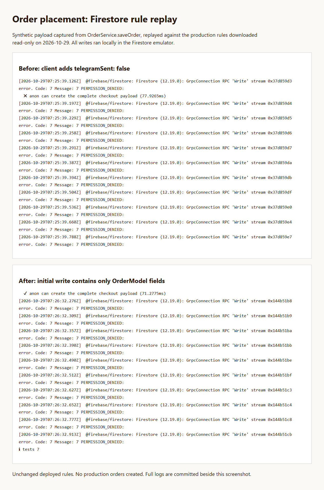

# Order placement regression

Verified on 2026-10-29. Production inspection was read-only. All order writes and notification probes used the Firestore emulator and synthetic customer data. Telegram transport was simulated, so no messages were sent.

## Cause and fix

The production `cloud.firestore` release points to ruleset `fe894e6c-a23d-4e50-a890-99275b632daf`, last updated 2026-09-28. Its order-create allowlist does not include `telegramSent`. `OrderService.saveOrder` added `telegramSent: false` to every initial order write, so Firestore returned `permission-denied` and checkout showed its save-error message.

The initial write now contains only `OrderModel.toJson()`. The notification function records its result afterward using the Admin SDK. Production also contains rules for services absent from this checkout, so deploying the local rules wholesale would have changed unrelated behavior. No rules were deployed.

## Before and after



This image displays captured test output, not a screenshot of customer checkout.

- [Before](order-placement-before.txt): the actual pre-fix `saveOrder` payload fails against the downloaded production rules with `PERMISSION_DENIED`. Six tests pass and the complete-checkout-payload test fails.
- [After](order-placement-after.txt): the actual fixed payload passes against the same downloaded production rules. All seven tests pass, including checks that clients cannot read, update, or delete orders.
- [Final regression suite](order-placement-rules.txt): all eight tests pass against repository rules. This includes a separate replay against the captured production order-create block. It accepts the fixed payload and rejects the old payload with `telegramSent: false`.
- [Notification probe](order-notification-proof.txt): the actual callable handler adds `telegramSent: true` after simulated successful delivery. On simulated delivery failure it adds `telegramSent: false` and preserves the order ID and amount.

The captured production order-create block is in `functions/test/fixtures/deployed-order-create.rules`. The synthetic payload in `functions/test/fixtures/order-create.json` is captured from the actual `OrderService.saveOrder` write. The Flutter regression test checks that the fixture matches the write, including all payment and order fields.

## Commands and results

| Check | Result |
| --- | --- |
| `flutter test test/order_service_test.dart` before fix | Failed because the initial write contained `telegramSent` |
| `flutter analyze --no-fatal-infos --no-fatal-warnings` | Passed, with 103 existing informational/warning findings |
| `flutter test` | 36 passed |
| `flutter build web --release --base-href /kiosk/` | Passed |
| `npm --prefix functions test` | TypeScript build passed, 16 tests passed |
| `npm --prefix functions run test:rules` | 8 passed |
| `npm --prefix functions audit --audit-level=high` | Passed, 0 high/critical, 16 moderate findings remain |

The audit initially failed on the existing development dependency `re2js@2.8.6`. The lockfile now resolves `2.9.1`. Functions tests and rules tests passed after the update.

To replay a downloaded production rules file locally, set `FIRESTORE_RULES_FILE` to its absolute path before running `npm --prefix functions run test:rules`. `ORDER_PAYLOAD_FILE` can select a captured payload. Neither variable changes production.

To regenerate the payload fixture:

```sh
ORDER_PAYLOAD_OUTPUT=functions/test/fixtures/order-create.json flutter test test/order_service_test.dart
```

To rerun the notification probe from the repository root:

```sh
npm --prefix functions run build
npx firebase-tools emulators:exec --only firestore "node docs/evidence/order-notification-probe.cjs"
```

Local emulator runs used Java 21 from Android Studio. Git Bash required `MSYS_NO_PATHCONV=1` for the web build so `/kiosk/` was not converted to a Windows path.

## CI follow-up

The first Linux CI run exposed a timezone-dependent fixture serializer in the new regression test. `Timestamp.toDate()` returns local time, so the Windows fixture contained `12:00` while Linux produced `04:00` for the same instant. This affected test serialization only.

The serializer now calls `toUtc()` before `toIso8601String()`, and an explicit assertion requires `2026-10-29T04:00:00.000Z`. That assertion failed locally before the correction. After regenerating the fixture, all 36 Flutter tests, analysis, and all eight rules tests passed. [Captured before/after output](order-placement-timezone.txt).

## Review and limits

The diff was reviewed against `origin/main`. The core safety fact was executed: server notification status updates work when that field is absent at creation. No payment calculations, notification formatting, client access rules, or visible UI changed. The only production code change removes the rejected creation field; an optional Firestore dependency supports capture of the real write in tests.

The harness reports `PI_MODEL=codex/gpt-6.1-sol`, so the full-send workflow's Sol self-review exception applied. No subagents were used.

No live customer order, real payment, or real Telegram delivery was performed. The emulator replay proves compatibility with the inspected production rules; the release build proves the fixed client compiles.
