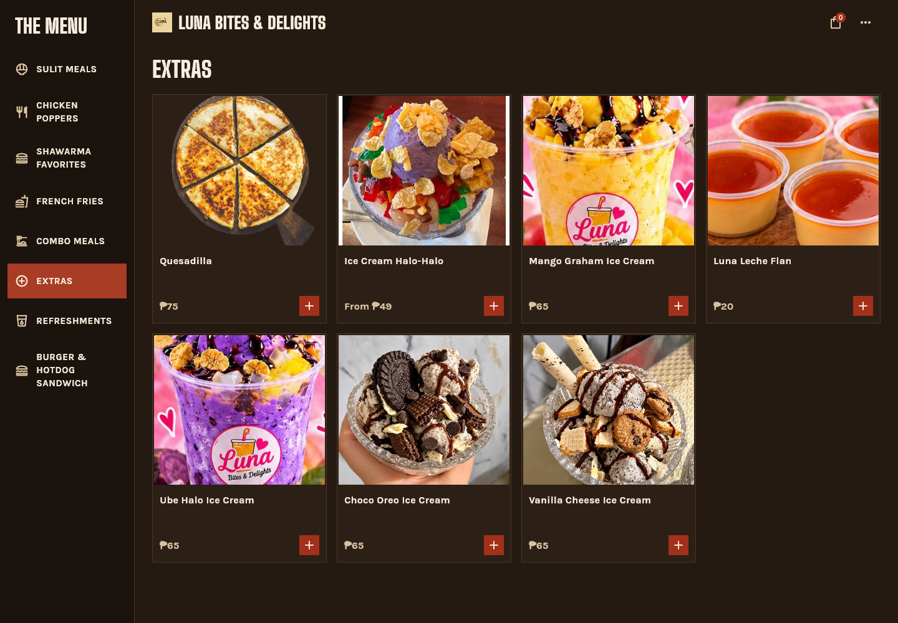
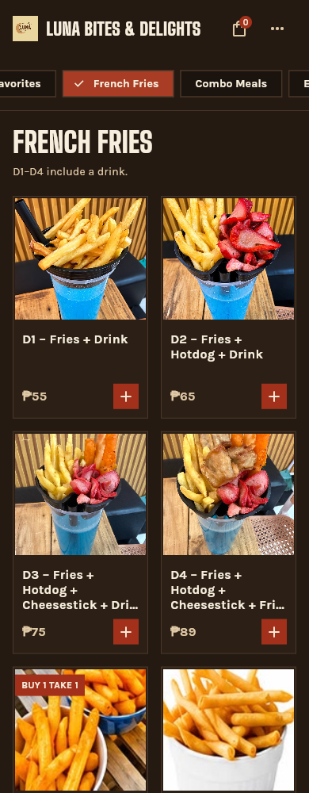
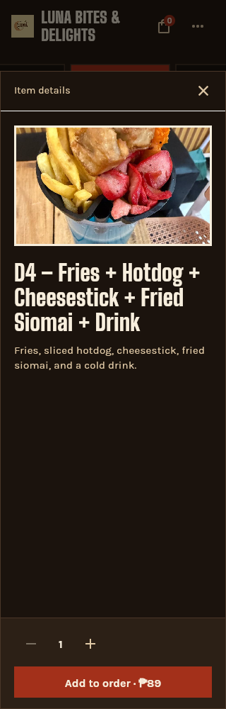

# Owner dessert, combo and fries/drink menu update

## Source and resulting menu

Fifteen owner-uploaded images are preserved in `docs/reference/menu-update/`. The posters are the authority for names, prices and bundle contents; the unlabelled product photos are mapped to the visually matching dessert and D1–D4 products. `docs/owner-menu-crops.json` records every crop, and `dart run tool/crop_owner_menu.dart` regenerates the sixteen shipping JPEGs. No generated food imagery or retouching is used. Tall product photos are cover-cropped by the existing menu cards; full ingredients and inclusion details remain in the chooser.

| Poster item | Price | Contents / change |
| --- | ---: | --- |
| Ube Halo Ice Cream | ₱65 | Added to Extras |
| Mango Graham Ice Cream | ₱65 | Updated name and photo |
| Choco Oreo Ice Cream | ₱65 | Added to Extras |
| Vanilla Cheese Ice Cream | ₱65 | Added to Extras |
| Luna Leche Flan | ₱20 | Updated name and photo |
| Combo 1 | ₱60 | Burger + fries; updated photo |
| Combo 2 | ₱99 | Shawarma wrap + fries; replaces the old hotdog combo listing |
| Super Combo 1 | ₱99 | Burger + fries + one drink |
| Super Combo 2 | ₱128 | Shawarma wrap + fries + one drink; consolidates the old shawarma-category listing |
| Combo 3 / Couple Snack Combo | ₱169 | Two burgers + one regular fries + two drinks |
| Combo 4 | ₱139 | Shawarma wrap + burger + fries; added |
| Combo 6 | ₱150 | Shawarma wrap + shawarma burger + one drink; replaces the old ₱149 listing |
| D1 | ₱55 | Fries + drink |
| D2 | ₱65 | Fries + hotdog + drink |
| D3 | ₱75 | Fries + hotdog + cheesestick + drink |
| D4 | ₱89 | Fries + hotdog + cheesestick + fried siomai + drink |

Unrelated menu items remain, including the distinct ₱149 halo-halo/fries/wrap promotion and Solo/Overload halo-halo. No Combo 5, drink size or drink-flavour choices were invented. The storefront price board reflects the same additions. It keeps its existing CSS and balances its columns by grouping combos beneath shawarma.

## Validation

- `flutter pub get` resolved dependencies but exited at the Windows Developer Mode/symlink requirement. Subsequent Flutter checks used `--no-pub`. SDK-induced changes to four lockfile versions were restored; this update does not change dependencies.
- `flutter analyze --no-pub --no-fatal-infos --no-fatal-warnings`: exit 0, 103 informational findings, no errors or warnings. The analyzer ran after the menu and crop-tool changes; the final test-only addition was compiled and executed by the test suite.
- `flutter test --no-pub`: **35 tests passed**. Includes menu/server price parity and three added 320px chooser tests: D4, Combo 6 and Vanilla Cheese each reach the cart at their actual price with quantity two.
- `flutter build web --no-pub --release --base-href /kiosk/`: passed. `dart run tool/assemble_site.dart`: passed. The build reports the existing loader deprecation and Wasm dry-run incompatibilities; the JavaScript release succeeds. After the final crop and storefront grouping refinements, those static assets were copied into the assembled build before refreshing screenshots; no Dart runtime source changed after compilation.
- Functions: `npm ci`, `npm run build`, `npm test`: passed; **16 tests passed**. `npm audit --audit-level=high`: exit 0, **16 moderate advisories**, no high/critical advisories.
- `dart format` on changed Dart files and `git diff --check`: passed.
- Rules were not changed; local emulator tests were not run. No live checkout, payment, order submission or external notification was performed.

## Rendered evidence

Actual assembled Flutter release and storefront served locally. A fresh headless Edge/Playwright context captured each viewport. Browser-tool capture was unavailable due to its workspace-root path restriction; the independent capture used the same local app. Flutter semantics were enabled for navigation; category-strip scrolling uses its accessible scroll container.

| View | 320px | 390px | 768px | 1440px |
| --- | --- | --- | --- | --- |
| Combo grid | [image](owner-combos-320.png) | [image](owner-combos-390.png) | [image](owner-combos-768.png) | [image](owner-combos-1440.png) |
| Desserts in Extras | [image](owner-desserts-320.png) | [image](owner-desserts-390.png) | [image](owner-desserts-768.png) | [image](owner-desserts-1440.png) |
| D1–D4 fries grid | [image](owner-fries-320.png) | [image](owner-fries-390.png) | [image](owner-fries-768.png) | [image](owner-fries-1440.png) |
| Storefront price board | [image](owner-storefront-320.png) | [image](owner-storefront-390.png) | [image](owner-storefront-768.png) | [image](owner-storefront-1440.png) |

Visual review: menu photographs load; category labels, prices and action buttons remain visible; long D3/D4 grid titles use the existing three-line ellipsis, with the complete D4 title and ingredients readable in its 320px details sheet. The Add to order button shows ₱89 without requiring an option. The fixed-quantity cart behavior is covered by widget tests. Storefront names wrap while amounts stay visible, with no horizontal overflow at any of the four widths. `owner-menu-render-checks.json` records viewport/scroll widths and zero page JavaScript errors for the menu runs. These are viewport captures of each menu category, not proof that every offscreen item fits in one phone viewport.

The Impeccable detector produced 45 cramped-padding warnings during the content pass (`owner-menu-detector.json`). The stylesheet is unchanged; its existing continuous-board rows use 13px vertical padding, column insets 20–30px, and intentionally remove bottom padding on the last row. Rendered checks found no clipped prices or controls. The final grouping adjustment reuses those same classes.

## Compatibility and deployment

The server price allowlist and tracked compiled Functions output include all new names/prices. Previous menu names and their existing prices remain accepted for carts from cached clients, including the former ₱149 shawarma bundle. Staff may therefore still receive an old named item from a cached kiosk until it refreshes. No database migration is required.

Merging to main runs the existing workflow: it deploys Hosting first, then deletes and redeploys `createCheckoutSession` / `paymongoWebhook` as part of the Functions release. New-name GCash checkout depends on that Functions deployment finishing; the sequence can leave a temporary checkout mismatch or outage. No production deploy was performed during this change.
