# Pink order pad redesign

The owner's circular pink-and-yellow logo replaces the crescent logo. The storefront, Flutter ordering flow and staff tools now share blush grounds, paper panels, pink actions, butter-yellow highlights and bundled Bricolage type. Caveat marks quantities and handwritten captions. The cart is one ruled order slip.

## Rendered evidence

All after captures are real Chrome renders of the local release build, assembled with the storefront at `/` and Flutter at `/kiosk/`. These screenshots use the business menu assets. Cart contents are local, in-memory selections. No order or payment was submitted.

| View | Capture |
|---|---|
| Storefront, 320 × 900 | 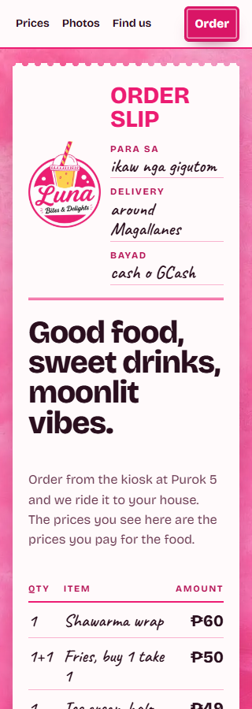 |
| Storefront, 390 × 900 | 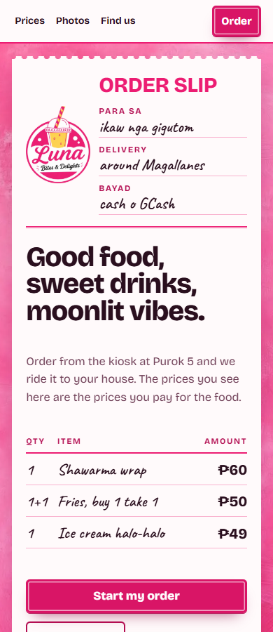 |
| Storefront, 768 × 1024 | 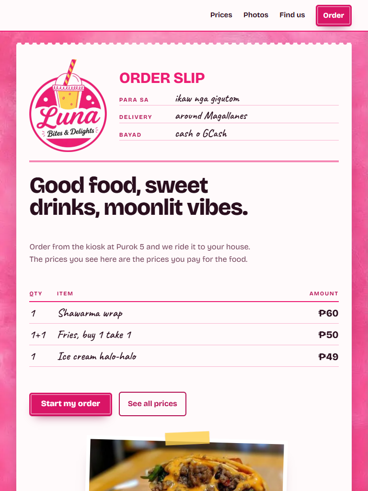 |
| Storefront, 1440 × 1000 | 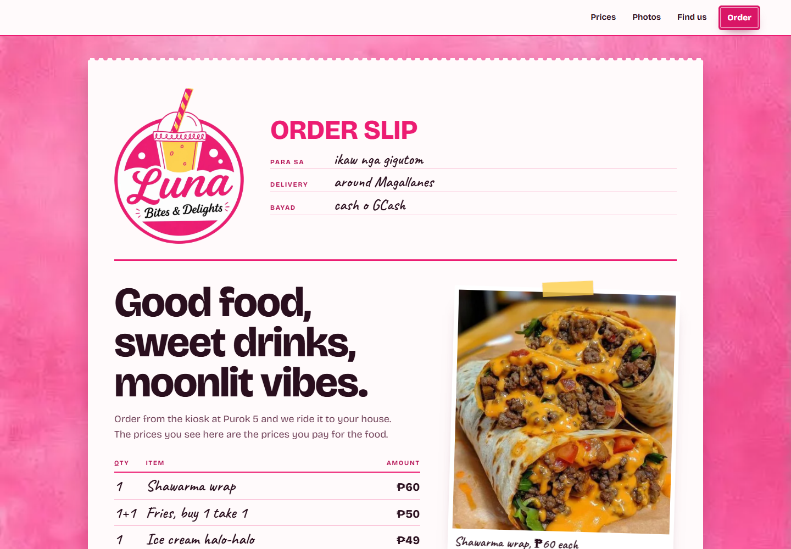 |
| Menu and prices, 1440 × 1000 | 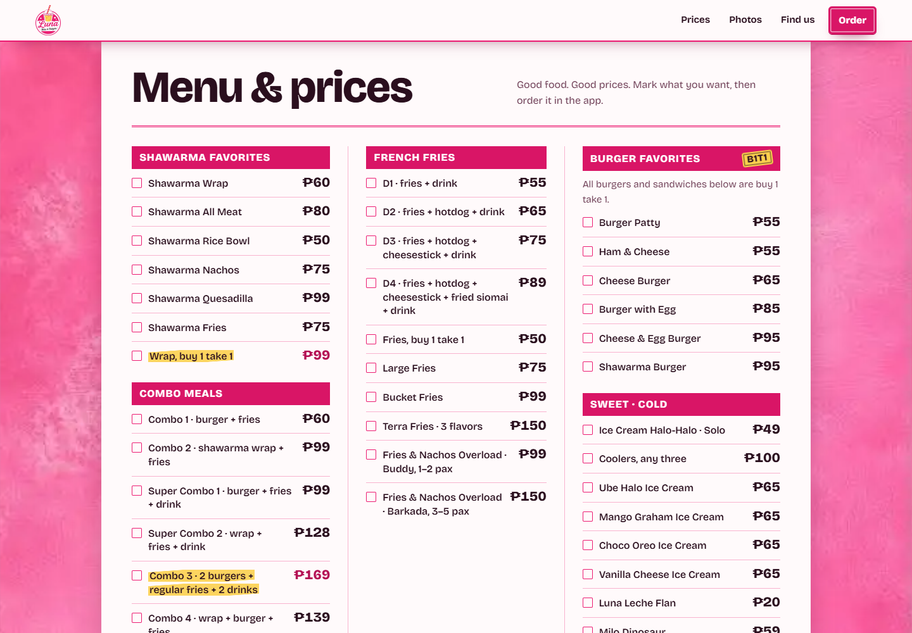 |
| Kiosk splash, 390 × 844 | 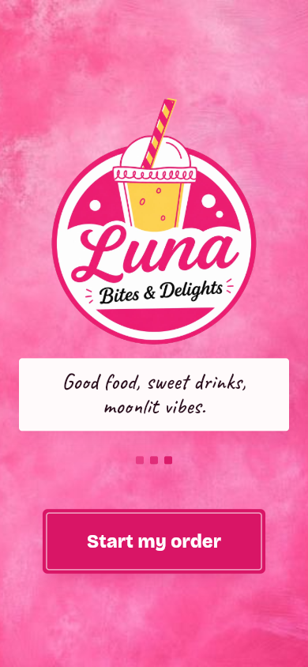 |
| Kiosk menu, 320 × 740 | 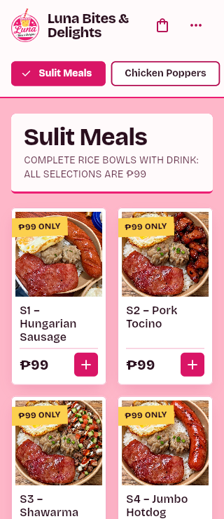 |
| Kiosk menu, 390 × 844 | 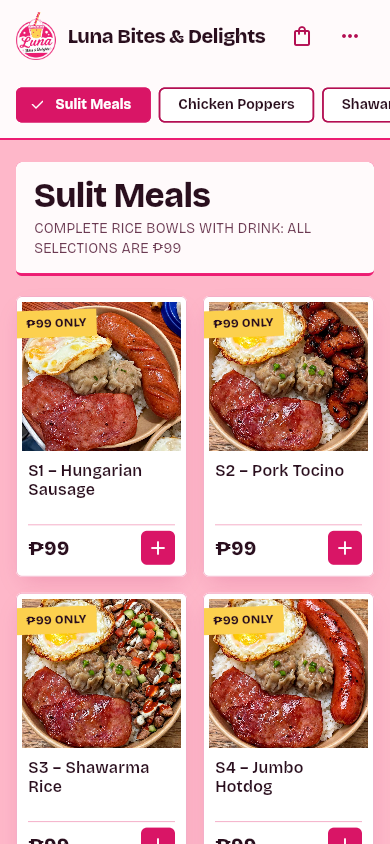 |
| Kiosk menu, 768 × 1024 | 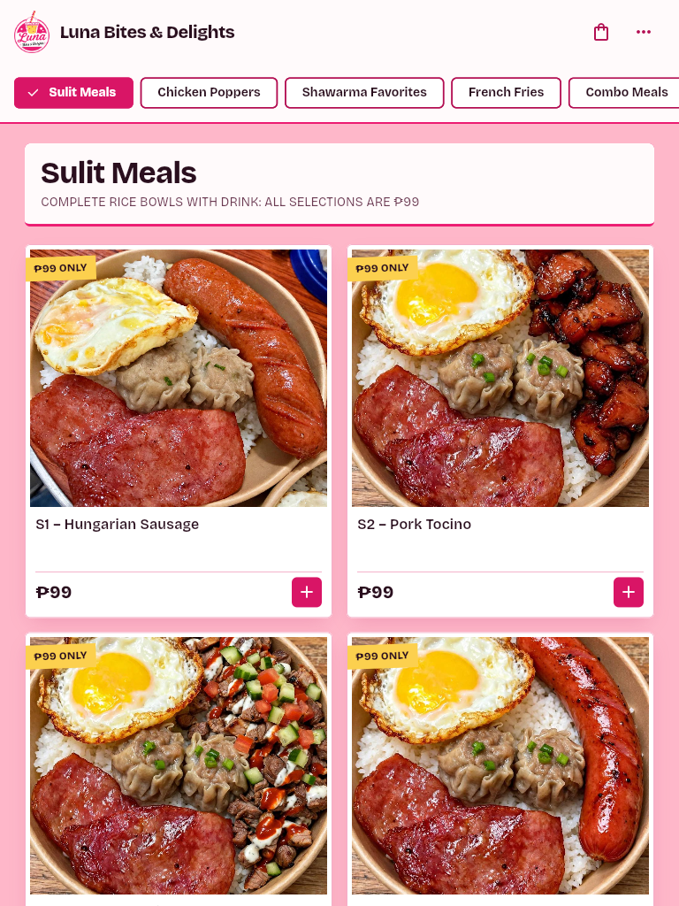 |
| Kiosk menu, 1440 × 900 | 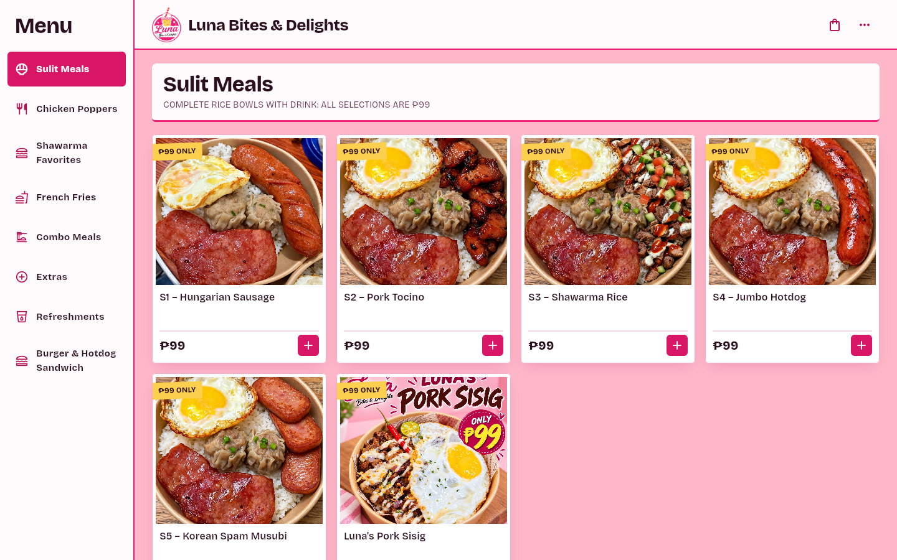 |
| Item chooser, 390 × 844 | 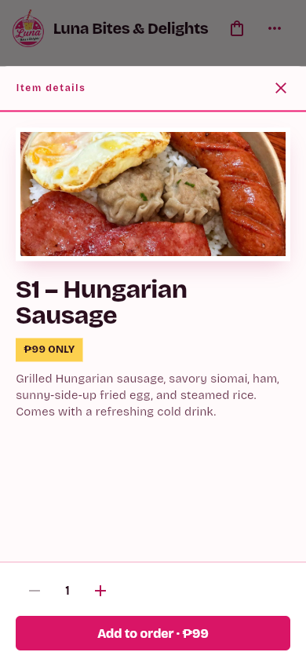 |
| Order slip, 390 × 844 | 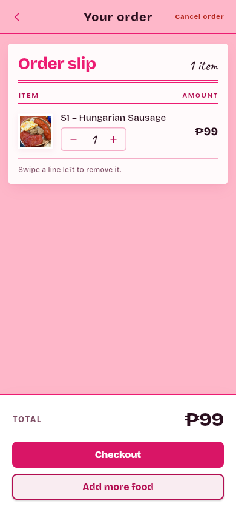 |
| Checkout, 390 × 844 | 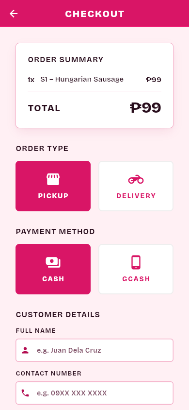 |
| Staff login, 390 × 844 | 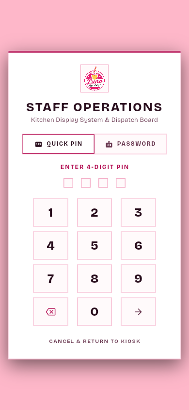 |

The old menu is recorded in [the previous continuity evidence](menu-continuity.md). Those are earlier committed captures, not a fresh baseline from this session.

## Checks

- `flutter analyze --no-fatal-infos --no-fatal-warnings`: passes with 87 existing or non-fatal diagnostic findings and no errors. Full output: [pink-analyze.txt](pink-analyze.txt).
- `flutter test`: all 37 tests pass. Full output: [pink-tests.txt](pink-tests.txt).
- The ordering tests execute the real item chooser and cart: variants, quantity pricing, multi-select limits, fixed bundle totals, cancel without adding, 320px menu at 2× text size, cart increment and cart cancellation back to the registered `/` route.
- `MSYS_NO_PATHCONV=1 flutter build web --release --base-href /kiosk/` and `dart run tool/assemble_site.dart`: pass.
- Functions: `npm ci`, `npm run build`, and `npm audit --audit-level=high` pass. Audit reports 16 moderate advisories, no high or critical findings. Rules are unchanged; emulator validation also runs in PR CI.
- Browser: storefront scroll width equals viewport width at 320, 390, 768 and 1440. Keyboard focus is visible. Menu opens details, adding updates the order bar, cart opens checkout with the correct total. A fresh Chrome session on a new local port completed menu → chooser → cart → checkout with an empty browser error log. Older retained errors in the prior multi-build browser session did not reproduce there.
- Contrast: white on Plate Pink is 4.94:1; Ink on Paper is 17.14:1; Pink Ink on Paper is 6.55:1. Logo Pink is reserved for large text and rules. Butter badges use Ink.
- Asset provenance: Impeccable scan reports 11 storefront rasters, 0 missing source records. New logo and wash assets come from the owner's attachments. Font sources and licenses are recorded in `assets/fonts/README.md`.

## Review and limits

The Impeccable finish and documentation passes were performed in this thread because project instructions prohibit delegation without a user request. The current model identifies itself as Sol, so the full-stop workflow's separate Sol review was skipped; the diff received a local review instead.

The visual pass found and corrected the kiosk header eyebrow, splash eyebrow, missing delivery-stub tear line, low-contrast B1T1 stamp, staff-role badge and light-background count badges. The final captures show the corrected customer UI. The shared theme also applies to analytics, receipts, payment screens and staff tools; authenticated operational data, payment completion and a live delivery were not exercised. Existing staff widget tests pass, including the auth dialog and operations board.

The design detector compared the replacement against the retired design file and reported expected token drift. Its real contrast finding on the butter stamp was corrected. Ruled form lines intentionally use compact row padding. DESIGN.md and its sidecar now describe the replacement system.

## Scope of risk

The key safety fact is that visual changes preserve order totals and required option rules. The existing ordering tests and the new cart test execute those paths; the fresh browser flow confirms a ₱99 item reaches checkout as ₱99. Menu data, order payloads, payment APIs and Firestore rules are unchanged.

The branch is reversible, but its shared theme affects both customers and staff. Review the Firebase preview before merging. Installed app icons may remain cached until the browser refreshes its PWA metadata. No native device build was performed.
