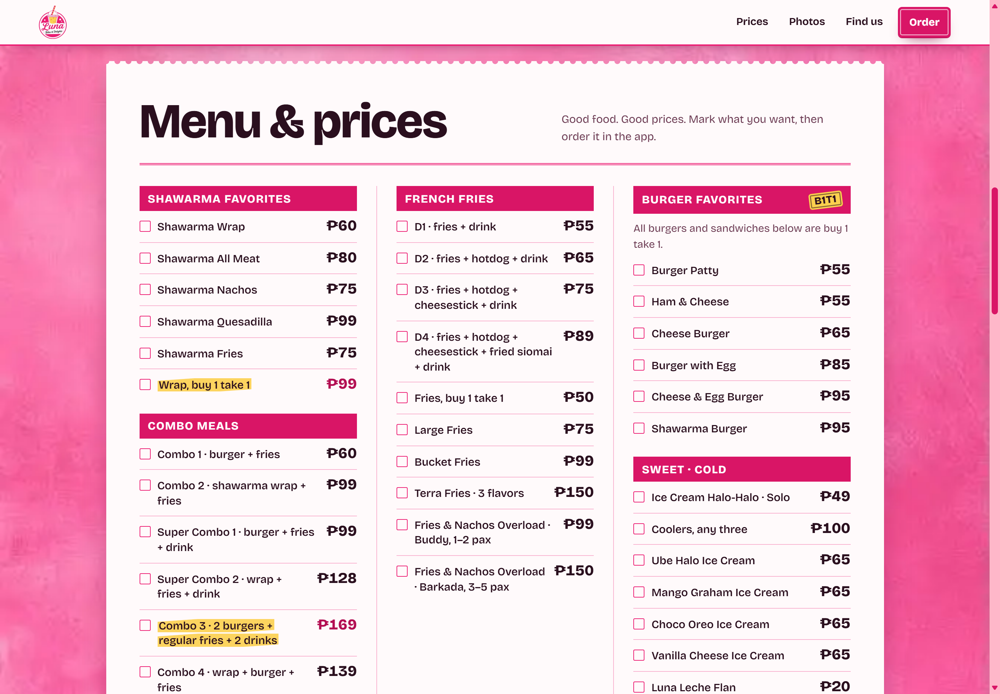
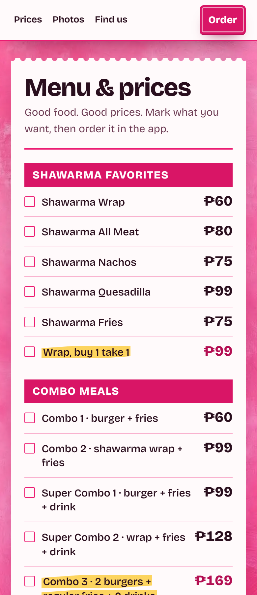
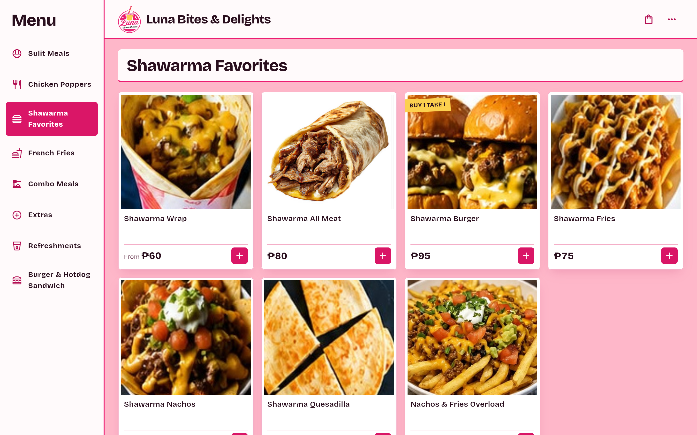
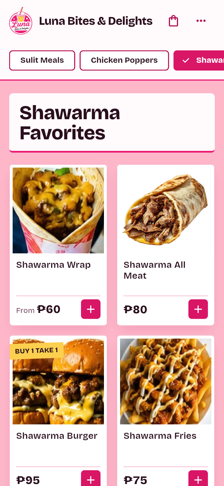
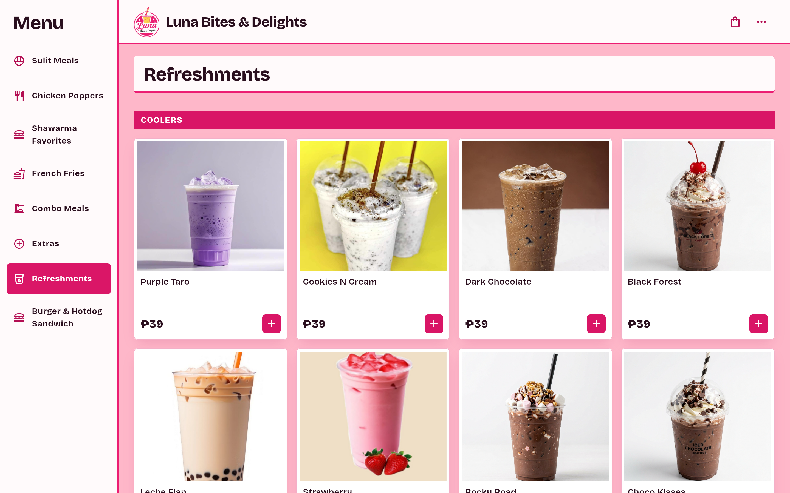
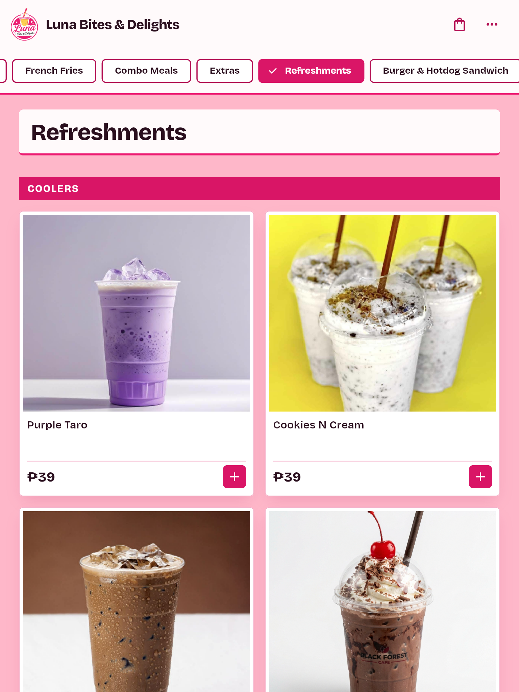
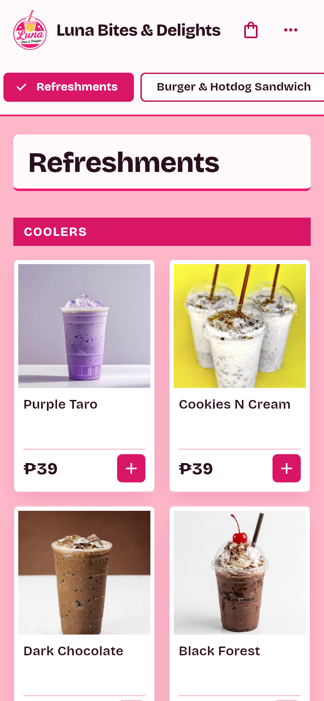
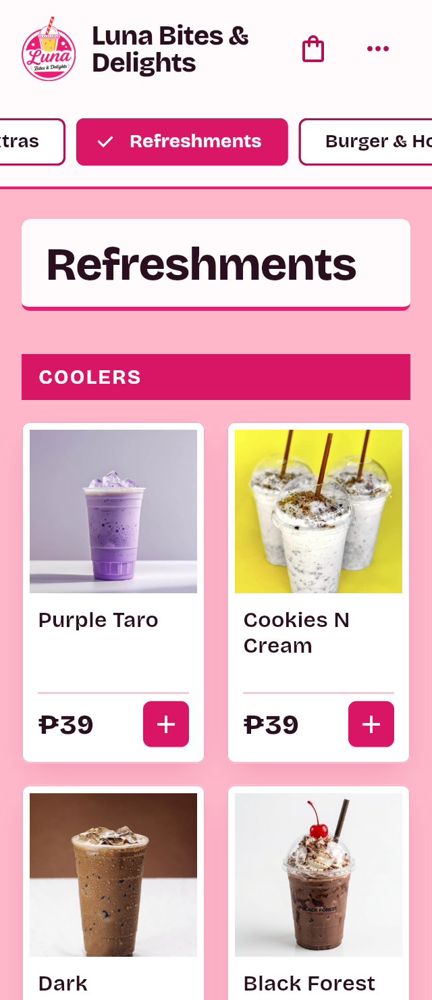

# Menu Update: Remove Shawarma Rice Bowl & Remove "Large" Indicator in Drinks

Branch: `t3/remove-shawarma-large-drink-labels`

## Summary

This update completes two menu changes:
1. **Remove Shawarma Rice Bowl**: Retired the standalone ₱50 Shawarma Rice Bowl from all ordering surfaces and documentation (kiosk, storefront price boards, Schema.org metadata, AI directory, and product documentation). The distinct Sulit Meal (`S3 – Shawarma Rice` at ₱99 with egg, siomai, ham, rice, and drink) remains available as intended.
2. **Remove "Large" Indicator on All Drinks**: Removed the `promoLabel: 'LARGE'` badge that was stamped across all 30 drink menu items in the kiosk app (Coolers, Lemon Series, Soda Pop, Oreo Craze, Milo Craze, Cream Float Craze). Drink cards now render clean, unobstructed food photography. Buy 1 Take 1 fruit sodas now cleanly show their `BUY 1 TAKE 1` badge rather than being overridden by the "LARGE" banner.

## Changes by Surface

| Surface | Before | After |
|---|---|---|
| `lib/data/menu_data.dart` (Shawarma Favorites) | Standalone `Shawarma Rice Bowl` at ₱50 (item `s3`) | Removed |
| `lib/data/menu_data.dart` (Refreshments / Drinks) | 30 drink items carried `promoLabel: 'LARGE'` badge; descriptions stated "Refreshing and large!" | `promoLabel: 'LARGE'` removed across all drinks; descriptions cleaned |
| `lib/screens/kds_page.dart` | Sample fallback order referenced retired `Shawarma Rice Bowl` | Replaced with active `Shawarma Wrap` order |
| `site/index.html` (Storefront Price Board) | Listed `Shawarma Rice Bowl` at ₱50 | Removed from Shawarma Favorites |
| `site/menu/index.html` (Full Menu & Schema.org) | Listed `Shawarma Rice Bowl` in Schema.org JSON-LD and HTML price board | Removed from JSON-LD and HTML list |
| `site/llms.txt` | Listed `Shawarma Rice Bowl: ₱50` | Removed from Shawarma Favorites |
| `PRODUCT.md` | Documented owner favorites poster standalone `Shawarma Rice Bowl` at ₱50 | Updated documentation to reflect retirement |
| `functions/src/payments/create_checkout.ts` | Server-side active `MENU_PRICES` included `Shawarma Rice Bowl` | Moved to cached clients allowlist |
| `test/regression_test.dart` | Tested presence of standalone `s3` rice bowl | Updated test to assert `Shawarma Rice Bowl` is retired and no drink carries a `LARGE` promo label |

## Visual Proof

### 1. Storefront Menu & Prices (Shawarma Rice Bowl Removed)

*Desktop 1440px storefront price board showing Shawarma Favorites with Shawarma Wrap, All Meat, Nachos, Quesadilla, Fries, and Wrap B1T1 — Shawarma Rice Bowl is removed.*

*Mobile 390px view of the printed order slip showing Shawarma Favorites with no Shawarma Rice Bowl.*

### 2. Kiosk App — Shawarma Favorites Category

*Desktop 1440px Flutter kiosk ordering app showing Shawarma Favorites category grid without Shawarma Rice Bowl.*

*Mobile 390px Flutter kiosk ordering app showing Shawarma Favorites category.*

### 3. Kiosk App — Refreshments Category ("Large" Indicator Removed)

*Desktop 1440px view showing Refreshments (Coolers) without the yellow "LARGE" banner overlay.*

*Tablet 768px view showing Refreshments category with clean drink cards.*

*Mobile 390px view showing Refreshments category with clean drink cards.*

*Narrow mobile 320px view showing Refreshments category with clean product imagery.*

## Verification & CI Parity

Every job in `.github/workflows/pr-checks.yml` was executed locally:

| Job | Command | Result |
|---|---|---|
| flutter (analyze) | `flutter analyze --no-fatal-infos --no-fatal-warnings` + baseline check | 87 issues, baseline 87 — PASS |
| flutter (format) | `dart format --output=none --set-exit-if-changed` | 0 changed — PASS |
| flutter (tests) | `flutter test` | 39 passed, 0 failed — PASS |
| flutter (web build) | `flutter build web --release` | Built release web app — PASS |
| functions (build) | `cd functions && npm run build` | TypeScript compiled `src/` to `lib/` — PASS |
| functions (audit) | `cd functions && npm audit --audit-level=high` | 0 high or critical vulnerabilities — PASS |
| functions (tests) | `cd functions && npm test` | 16 passed, 0 failed — PASS |
| proof (verification) | `node tool/check_pr_proof.mjs` | Proof check passed — PASS |
