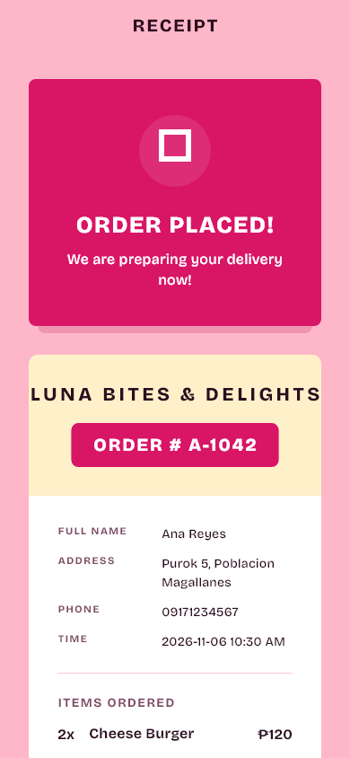
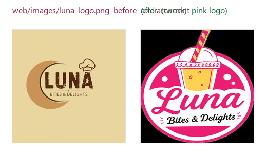

# Rename: luna_express → Luna Bites & Delights

Branch: `t3/rename-project-luna-bites-delights`

## Problem

The app shipped as "Luna Bites & Delights" in every user-facing surface, but the
project identity was still the legacy `luna_express`: the Dart package, the
Android namespace and applicationId, the iOS/macOS bundle identifiers, the
desktop binary names, and the GitHub repository. Two user-facing strings also
still said "LUNA EXPRESS" — the receipt header and the KDS delivery dispatch
note.

## What changed

| Surface | Before | After |
|---|---|---|
| Dart package | `luna_express` | `luna_bites_and_delights` |
| Android namespace / applicationId | `com.example.luna_express` | `com.lunabitesanddelights.app` |
| iOS / macOS bundle id | `com.example.lunaExpress` | `com.lunabitesanddelights.app` |
| Desktop binary name | `luna_express` | `lunabitesanddelights` |
| macOS product name | `luna_express` | `Luna Bites & Delights` |
| Receipt header | `LUNA EXPRESS` | `LUNA BITES & DELIGHTS` |
| KDS dispatch note | `LUNA EXPRESS DELIVERY` | `LUNA BITES & DELIGHTS` |
| GitHub repository | `khentmoba/LUNA_EXPRESS` | `khentmoba/LunaBitesAndDelights` |

Deliberately unchanged: the Firebase project id `lunaexpress`, the
`lunaexpress.web.app` 301 redirect site, and the
`FIREBASE_SERVICE_ACCOUNT_LUNAEXPRESS` Actions secret. Cloud project ids are
immutable and the redirect has to keep serving.

## Proof

Real render of `ReceiptPage` at 390×844 @3x with the app's own Bricolage and
Caveat fonts loaded, captured through `flutter_tester`. Two changes are visible:
the header carries the current brand, and the duplicate second brand line is
gone. The `FittedBox` keeps the longer name on one line; without it the header
wrapped as `LUNA BITES &` / `DELIGHTS`.

`test/brand_identity_test.dart` locks this in: it asserts the receipt renders
`LUNA BITES & DELIGHTS` and that neither `LUNA EXPRESS` nor `Luna Express`
appears anywhere on the page.

### Stale web copy of the logo

`web/images/luna_logo.png` still held the pre-`75f4ea5` artwork (mean absolute
difference 0.3/255 against the old logo, 63.1/255 against the current one). It
was unreferenced — nothing loads it — so it is replaced with the current logo
rather than deleted.

### Local CI parity

Every job in `.github/workflows/pr-checks.yml`, run on this branch:

| Job | Command | Result | Log |
|---|---|---|---|
| flutter | `flutter analyze` + baseline | 87 issues, baseline 87 — pass | `flutter-analyze.txt` |
| flutter | `dart format --set-exit-if-changed` (10 changed files) | 0 changed | `dart-format.txt` |
| flutter | `flutter test` | 38 passed | `flutter-test.txt` |
| flutter | `flutter build web --release` | built `build/web` | `flutter-build-web.txt` |
| functions | `npm ci` / `npm run build` / `npm audit --audit-level=high` | all exit 0; 15 moderate, no high/critical | `functions-job.txt` |
| rules | `npm run test:rules` (Firestore emulator, JDK 21) | 8 passed, 0 failed | `rules-job.txt` |

### Native identifier consistency

`native-config-check.txt` asserts the identifiers agree across every platform:
macOS `PRODUCT_NAME` matches the scheme's `BuildableName`, iOS `CFBundleName`
and both bundle ids, Android `namespace` equals `applicationId` and matches the
`MainActivity` package, both desktop `BINARY_NAME`s, the pubspec name, and that
no Dart file still imports `package:luna_express/`. Result: **ALL PASS**.

## Not verified, and why

- **Android and Windows builds fail on this branch and on `main`.** Both stop at
  `lib/services/location.dart:2` — `import 'dart:js'`, which is unavailable on
  those platforms (`android-build.txt`, `windows-build.txt`). That file is
  untouched by this branch (`git log origin/main..HEAD --
  lib/services/location.dart` is empty) and `origin/main` carries the same import,
  so the failure predates the rename. The identifier changes could therefore not
  be build-verified on those targets; they are covered by the consistency check
  above and by `flutter analyze`.
- **iOS, macOS and Linux were not built.** No Xcode or Linux toolchain on this
  host. Their changes are config, plist, scheme and CMake edits, covered by the
  consistency check.
- **The KDS Telegram dispatch note was not sent.** The string lives inside the
  private `_copyRiderDispatchNote`, which needs a Firestore-backed order on the
  KDS board to reach. Verified by source inspection only.
- **`npm run check:rules-drift` could not run** — it needs Google Cloud
  credentials (exit 2, "Could not load the default credentials", `rules-drift.txt`).
  It is not a PR gate; `.github/workflows/rules-drift.yml` runs it on push to
  `main`, on a schedule, and on demand.
