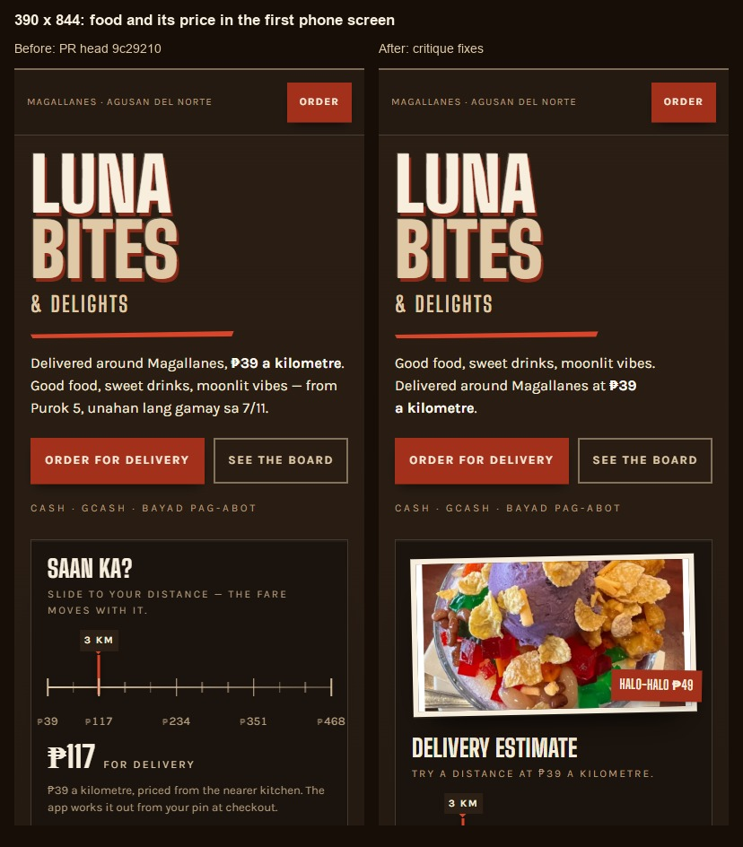
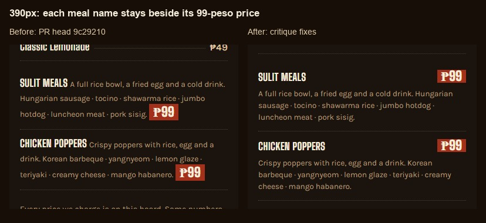
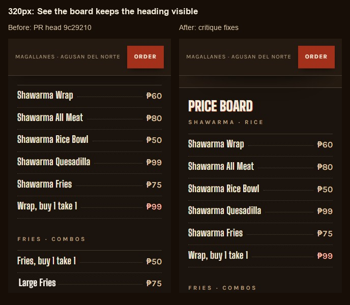

# Impeccable critique fixes

Baseline: PR #5 at `9c292107d4264043618e1e4ea74fd9aff8fb6da5`.
After: the follow-up commit containing this file. Before captures came from the independent critique of the Firebase PR preview; after captures came from the local static source using native agent-browser Chrome.

The two independent reviewers used GPT-6.1-Sol with thinking set to medium. The critique scored 23/32 and identified five P2 priorities. This pass addresses those five priorities. The score is the original assessment, not a new score for the fixes.

## Visual proof

390 x 844, DPR 1. Before, the first food photo starts at approximately y847. After, it starts at y541 and the complete halo-halo 49-peso tag is visible by y706. At 320 x 740 the complete tag is visible by y704. The existing image is reused; there is no duplicate image or new asset request.

390px crops from full-page captures. The meal name and 99-peso price now share the first row; the description spans the next row. Browser assertions checked both offers at 320, 390 and 820px. Name and price baselines differ by less than one pixel.

320px after clicking See the board, cropped to the same 500px height. Before, the heading is under the sticky bar. After, the header bottom is y72.5 and the heading starts at y119.2. Direct #window and #find jumps also leave their headings below the header.

## Copy corrections

- The panel is labelled Delivery estimate; the readout says estimated fare. Visible help and the slider's accessible name describe a trial distance. Exact delivery pricing uses the pin and nearer kitchen at checkout.
- The price-board note says its prices match the app and links to the full menu. It no longer claims that every price appears on the board.
- Find Us applies the kilometre fare explicitly to delivery, separate from walking in.

## Validation

- `flutter analyze --no-fatal-infos --no-fatal-warnings`: exit 0, 135 informational findings after syncing main.
- `flutter test`: 22 passed after syncing main.
- `npm --prefix functions test`: build and 10 notification/payment regression tests passed after syncing main.
- `npm --prefix functions ci`: passed. The first local build lacked dependencies and could not find tsc; installing the lockfile dependencies resolved that environment failure.
- `npm --prefix functions run build`: passed.
- `npm --prefix functions audit --audit-level=high`: exit 0. It reports 15 moderate vulnerabilities; no high/critical finding fails the required gate.
- `node --check site/app.js` and `git diff --check`: passed.
- Native Chrome assertions: no horizontal overflow at 320, 390, 820 or 1440px; all five images loaded; both offer layouts aligned; food price inside tested phone viewports.
- Native keyboard: Home -> 1/39, ArrowLeft remains 1/39, End -> 12/468, ArrowRight remains 12/468, PageDown -> 9/351, ArrowLeft -> 8/312. ARIA and visible fares agree, including the new estimate wording.
- Native mouse: drag beyond the track clamps at 12km/468 pesos and release clears dragging state.
- Reduced-motion emulation: active, needle transition duration 1e-06s.
- Runtime page errors: none in the local static page.
- Impeccable detector: three cramped-padding warnings, the same false positives already verified by computed section padding in the critique. No new finding.
- Rules files are unchanged; the local rules emulator suite was not rerun for this static UI pass. The PR workflow runs it.

## Base integration

Main advanced while this follow-up was being prepared. It was merged into the PR branch after the UI commit. The two hosting-workflow conflicts were resolved by retaining both `/kiosk/` base href and site assembly from this PR, and the new `MAPTILER_KEY` build define from main. The static UI is identical to the captured `8ebb5af` implementation. The merge also retains main's payment fixes and Pasugo removal.

## Safety fact

Moving the photo and wrapping the estimator must not change the rail's behavior or the ordering destination. The running page passed real keyboard and mouse input checks after the DOM change, with visible values and ARIA synchronized. All five order links still point to `/kiosk/#/menu`. No kiosk Dart source, hosting rewrites or Functions source is changed in this follow-up.

## Limits

Chrome viewport emulation and mouse/keyboard input were used. Physical Android/iOS, Safari touch gestures, screen-reader speech, 200% browser zoom, slow-network performance, checkout submission and payments were not tested. No new usability score or conversion improvement is claimed.
