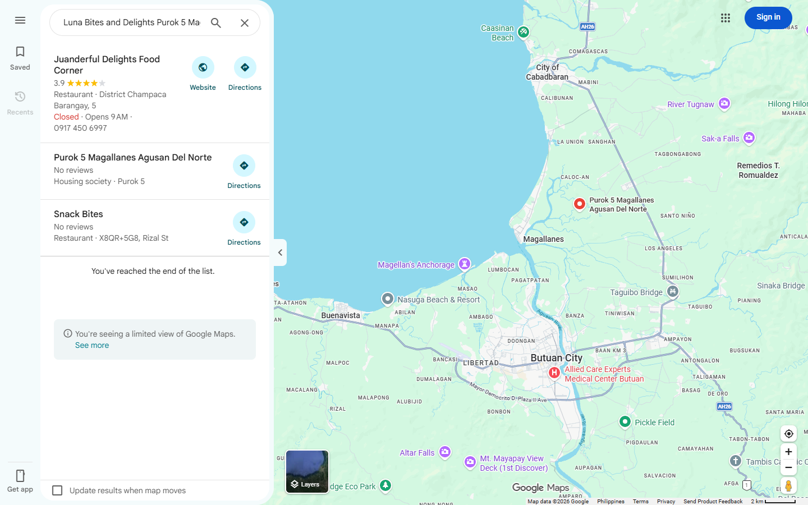
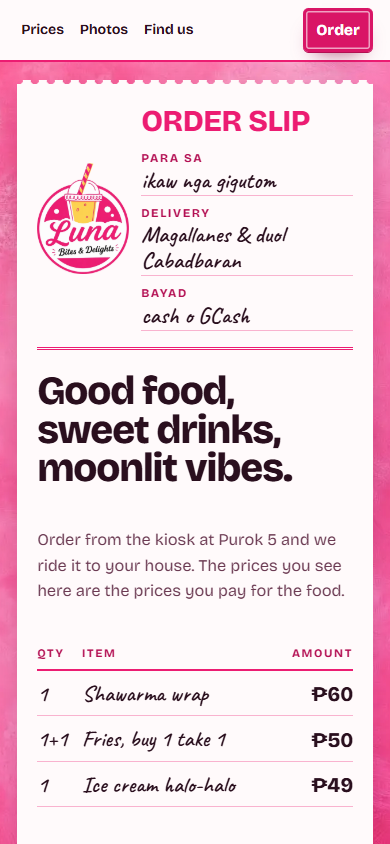
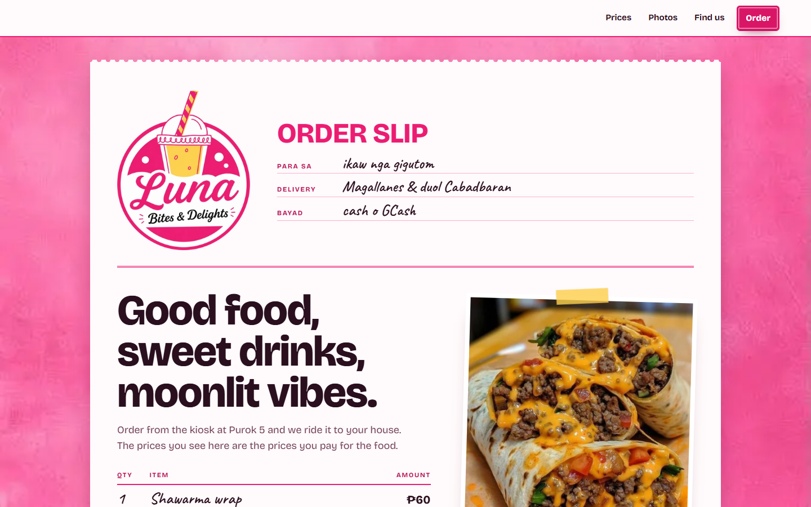

# SEO Benchmark — Luna Bites & Delights

**URL:** https://lunabitesanddelights.web.app/
**Captured:** 2026-11-05 (UTC)
**Scope:** technical SEO, on-page/content, performance, local search presence, authority/discoverability, and a local competitor comparison.
**Method:** live crawl of the production site, Lighthouse 12.8.2 (local Chrome, mobile + desktop), schema.org validator, Google Maps/Google autocomplete, Brave/DuckDuckGo/TinyFish SERP checks, Facebook public page, and public competitor listings.

> This is a measurement, not a self-assessment. Every score below is tied to an artifact in this folder.

---

## 1. Headline

| Measure | Result |
|---|---:|
| **Overall SEO benchmark** | **52 / 100** |
| Owned-web SEO (technical + on-page + performance) | **76 / 100** |
| Local discovery (GBP + reviews + citations + authority) | **22 / 100** |
| Lighthouse mobile (storefront) | **99 / 100** |
| Lighthouse desktop (storefront) | **100 / 100** |
| Lighthouse SEO category | **100 / 100** |
| Schema.org validation | **0 errors, 0 warnings** |
| Google Business Profile | **Not found** |
| Google reviews | **0** (no listing) |
| Facebook followers / reviews | **929 / 0** |

**The short version:** the storefront is technically excellent and fast. It is also nearly invisible where local customers actually search. There is no Google Business Profile, no phone number, no reviews, and no citation beyond Facebook. The canonical domain is not the one surfacing in brand searches — the old `lunaexpress.firebaseapp.com` host is. That combination caps the score at 52 despite a 99/100 Lighthouse run.

Lighthouse's SEO 100 only checks crawlability basics (title, meta, robots, links). It cannot see a missing map listing, missing reviews, or a brand SERP owned by Facebook.

**If you only do three things:** (1) create and verify a Google Business Profile, (2) add a phone number to the site, schema, Facebook, and GBP, (3) verify Search Console and fix the sitemap. Those three address the largest measured gaps.

**How to read the score:** 80+ strong · 60–79 solid with gaps · 40–59 visible weaknesses · below 40 critical. Luna is at 52: a strong website with a critical local-search gap.

---

## 2. Scorecard

| Pillar | Weight | Score | What drove the score |
|---|---:|---:|---|
| Technical foundation | 20 | **16** | HTTPS/HSTS, robots.txt, valid JSON-LD, clean status codes, legacy 301s. Lost points for a sitemap fragment URL, stale `lastmod`, no canonical on `/kiosk/`, and a duplicate `firebaseapp.com` host. |
| On-page & content | 20 | **13** | Strong alt text, internal links, WebP images, clear pricing copy. Title is 76 chars, description 201 chars, H1 is a slogan with no category/location, only 484 visible words, no FAQ or menu page. |
| Performance & mobile UX | 15 | **13** | Mobile 99 / desktop 100, LCP 2.0 s / 0.7 s, CLS 0.004, TBT 30 ms, a11y 100. Lost points because every static asset is `no-store` and the hero logo ships 60 KiB more than needed. |
| Local search presence | 30 | **4** | No GBP, no Google reviews, no phone, Facebook-only citations. On-page local signals (address, map, hours, `areaServed`) are good but cannot compensate. |
| Authority & discoverability | 15 | **6** | Canonical host does not surface in brand queries; legacy host does. Brand SERP is Facebook. 929 engaged followers is the one real asset. |
| **Total** | **100** | **52** | |

**Sub-scores:** owned web **42/55 (76%)** · local discovery **10/45 (22%)**.

### Scoring rubric

Each criterion is scored from the evidence files, not from opinion. Half points are not used.

| Pillar | Criterion | Max | Score | Evidence |
|---|---|---:|---:|---|
| Technical | Crawl access & status codes | 5 | 5 | `robots.txt` 200, allow-all, sitemap declared; storefront 200; legacy 301; no `noindex` |
| Technical | Sitemap quality | 5 | 2 | Valid XML, but includes a fragment URL and has a stale `lastmod` |
| Technical | Canonicalization & duplicate hosts | 5 | 4 | Storefront self-canonical; kiosk has none; `firebaseapp.com` duplicate serves 200 |
| Technical | Structured data | 5 | 5 | schema.org validator: 0 errors, 0 warnings |
| On-page | Title tag | 4 | 2 | 76 chars, truncates; keyword-rich but too long |
| On-page | Meta description | 4 | 2 | 201 chars, truncates; front-loads offer and location |
| On-page | Heading structure & H1 intent | 4 | 2 | One H1, but it is a slogan with no category or location |
| On-page | Content depth & local coverage | 4 | 3 | 484 words; Magallanes ×5, Cabadbaran ×4; no FAQ/menu/delivery page |
| On-page | Image SEO, alt text, internal links | 4 | 4 | 8 images, all alt (2 decorative), WebP, dimensions, 17 internal links |
| Performance | Mobile Lighthouse | 5 | 5 | 99; LCP 2.0 s, CLS 0.004, TBT 30 ms |
| Performance | Desktop Lighthouse | 3 | 3 | 100; LCP 0.7 s |
| Performance | Accessibility & mobile usability | 4 | 4 | 100 a11y, 100 best practices, viewport, contrast, tap targets |
| Performance | Caching & repeat-visit efficiency | 3 | 1 | All static assets `no-store`; 309 KiB re-downloaded each visit |
| Local | Google Business Profile | 12 | 0 | No listing found across four query shapes and exact coordinates |
| Local | Reviews & ratings | 8 | 0 | 0 Google reviews (no GBP); Facebook "Not yet rated (0 reviews)" |
| Local | NAP consistency & phone | 5 | 3 | Address consistent; no phone anywhere |
| Local | Citations & directories | 5 | 1 | Facebook only |
| Authority | Canonical host indexation | 5 | 1 | `site:` returns 0 in TinyFish, DuckDuckGo, Brave; legacy host ranks instead |
| Authority | Brand SERP ownership | 4 | 1 | Facebook dominates; legacy host ranks; Brave returns unrelated brands |
| Authority | Backlinks / referring domains | 3 | 1 | Facebook profile/post links only |
| Authority | Social proof & activity | 3 | 3 | 929 followers, posts daily, replies to comments |
| **Total** | | **100** | **52** | |

---

## 3. Competitive benchmark

Local discovery is scored out of 45: GBP 12, reviews 8, NAP 5, citations 5, authority 15. Competitor scores are directional and based on public signals only; review counts are not exposed in the logged-out Google Maps view.

| Business | Owned site | Google Business Profile | Rating | Phone | Delivery marketplace | Local discovery |
|---|---|---:|---:|---|---|---:|
| **Luna Bites & Delights** (Magallanes) | Yes — 76/100 web | **No** | — | **No** | No | **10 / 45 (22%)** |
| **GZ Cafe** (Magallanes) | No | Yes | 5.0 | Yes | No | **33 / 45 (73%)** |
| **JM Shawarma** (Cabadbaran) | No | Yes (2 listings) | 2.0 / 4.8 | — | foodpanda | **31 / 45 (69%)** |
| **More Bites Pizza** (Cabadbaran) | No | Yes | 4.6 | — | No | **28 / 45 (62%)** |
| **Jollibee Cabadbaran** (chain) | Corporate site | Yes | 4.1 | Yes | Own app | not scored |

**Read:** Luna has the only real local independent website, and it is a good one. GZ Cafe has no website at all, yet it is far more discoverable locally because it has a GBP with a phone number and a 5.0 rating. That is the gap this benchmark exposes.

Local breakdown (GBP + reviews + NAP + citations + authority): GZ Cafe 12+6+5+1+9 = 33; JM Shawarma 10+4+4+4+9 = 31; More Bites 10+5+4+1+8 = 28; Luna 0+0+3+1+6 = 10.

### Google Maps evidence

Searching the storefront's own **"Open in Maps"** URL returns:

1. **Juanderful Delights Food Corner** — 3.9 — Nasipit
2. **Purok 5 Magallanes Agusan Del Norte** — housing society, no reviews
3. **Snack Bites** — no reviews

Luna is not in the list. Searching `Luna Bites and Delights` returns Corner Bites, Fat Chef, Luna Store, and Luna eatery and tindahan — all unrelated. Searching the exact coordinates returns a coordinate pin, not a business.



---

## 4. What is working

Measured, not claimed:

- **Storefront performance:** Lighthouse mobile 99, desktop 100. LCP 2.0 s mobile / 0.7 s desktop. CLS 0.004. TBT 30 ms. 309 KiB total.
- **Accessibility:** 100 on both form factors. Contrast, tap targets, labels, heading order, font size all pass.
- **Best practices:** 100. HTTPS, HSTS, `nosniff`, `X-Frame-Options: DENY`, referrer policy, permissions policy.
- **Structured data:** `FastFoodRestaurant` JSON-LD validates with 0 errors and 0 warnings. Includes name, aliases, address, geo, area served, hours, cuisine, payment, menu URL, Facebook `sameAs`.
- **Crawl access:** `robots.txt` allows all and declares the sitemap. No `noindex`. Legacy `lunaexpress.web.app` and `lunaexpress.firebaseapp.com` both 301 to the canonical host.
- **On-page craft:** 8 images, all with alt text (2 correctly empty for decorative logos), WebP, width/height set, hero preloads, font preload, no layout shift.
- **Content honesty:** prices match the menu, delivery fee is disclosed, local landmarks (7/11, Poblacion, Cabadbaran) are present, map and street view are embedded.
- **Social:** Facebook page is active (posted 7 hours before capture), 929 followers, replies to delivery questions.

Fresh renders:





---

## 5. What is holding it back

### P0 — No Google Business Profile found

This is the largest single gap. Without a GBP there is no map pack presence, no Google reviews, no calls, no direction requests, and no "near me" visibility. Competitors in Magallanes and nearby Cabadbaran have listings.

Evidence: `gbp-maps-results.txt`, `gbp-maps-search.png`, `competitor-gbp.txt`.

### P0 — No phone number on any public surface

The schema has no `telephone`. The footer and Find Us section have no phone. The public Facebook page does not show one. NAP is incomplete, customers cannot call, and GBP verification will be harder.

Evidence: `onpage-audit.txt`, `facebook-page.txt`.

### P1 — The canonical host is not the one ranking in the engines checked

Brand query results are dominated by Facebook and by `lunaexpress.firebaseapp.com` — the legacy host. The canonical `lunabitesanddelights.web.app` does not appear. `site:` queries return zero results in TinyFish, DuckDuckGo, and Brave. Google indexation cannot be confirmed without Search Console.

Evidence: `serp-brand-query.txt`.

### P1 — The sitemap contains an invalid URL

`sitemap.xml` includes `https://lunabitesanddelights.web.app/kiosk/#/menu`. Fragment URLs are invalid in sitemaps and are ignored by crawlers. The kiosk itself is a Flutter canvas with no indexable menu content, no canonical, no Open Graph, and no JSON-LD. `lastmod` is 2026-03-30 — stale.

Evidence: `onpage-audit.txt`, `live-home.html`.

### P1 — On-page targets are broad, not local-intent specific

- Title is 76 characters; description is 201. Both truncate in results.
- H1 is "Good food, sweet drinks, moonlit vibes." — no category, no location.
- 484 visible words. No FAQ, no delivery-area page, no about page, no menu page.
- Google autocomplete shows real demand for `cabadbaran food delivery`, `cabadbaran restaurant`, `cabadbaran burger`, `cabadbaran shawarma`. Luna has no page targeting those intents.
- The brand name collides with unrelated entities: `luna bites` autocompletes to market, night market, Dubai, Henderson, chocolate, Eden Park, sleep gummies.

Evidence: `onpage-audit.txt`, `serp-brand-query.txt`.

### P2 — Static assets are uncached

Every CSS, JS, image, and font response returns:

```
Cache-Control: no-cache, no-store, must-revalidate
```

Repeat visits re-download the full 309 KiB. This also wastes crawl capacity.

Evidence: `live-headers.txt`.

### P2 — The ordering app is heavy

The storefront is 99. The kiosk is not:

| Metric | Storefront | Kiosk |
|---|---:|---:|
| Performance | 99 | **62** |
| Total blocking time | 30 ms | **2,980 ms** |
| Time to interactive | 2.3 s | **16.7 s** |
| Total bytes | 309 KiB | **2,639 KiB** |

The drop happens after the customer clicks "Order".

Evidence: `lighthouse-summary.txt`, `lighthouse-kiosk.json`.

### P2 — No analytics; no visible Search Console verification

No GA4, GTM, Plausible, or Umami. No Search Console verification meta tag. There is no way to measure organic sessions, queries, or conversions from this work.

Evidence: `onpage-audit.txt`.

### P2 — Citations and social proof are thin

Only Facebook. No listing found in the directories checked (foodpanda, Grab, TripAdvisor, Yelp, Waze). 0 Google reviews, 0 Facebook reviews.

Evidence: `serp-brand-query.txt`, `facebook-page.txt`.

---

## 6. Prior benchmark vs measured reality

The previous document (`docs/evidence/local-seo-brand-benchmark.md`) reported a post-change composite of **94/100**. Those numbers were self-assessed, not measured. This run does not reproduce them.

| Prior claim | Measured on 2026-11-05 |
|---|---|
| Agentic recommendation 92/100 | No measurable evidence. Brand query returns Facebook and the legacy host; canonical host absent. Brave returns unrelated "Luna's Delights" entities. |
| Brand entity match 98/100 | Canonical host absent from brand SERP. Autocomplete collides with unrelated "Luna Bites" businesses. |
| Regional proximity 95/100 | On-page mentions are present, but there is no GBP, no citations, and no map pack presence. |
| Schema 100/100 | Valid (0 errors) but incomplete: no `telephone`, no Menu markup, no reviews. |
| Crawler directives 100/100 | `robots.txt`, `sitemap.xml`, and `llms.txt` exist, but the sitemap contains an invalid fragment URL and the kiosk is not indexable. |
| Composite 94/100 | **52/100** by this rubric. |

The prior work did add real assets — schema, robots, sitemap, `llms.txt`, canonical tags, brand unification. The mistake was scoring those assets as outcomes.

---

## 7. Action plan

### P0 — this week

| # | Action | Why | Effort |
|---|---|---|---|
| 1 | **Create and verify a Google Business Profile** at Purok 5, Poblacion, Magallanes. Category: Fast food restaurant / Food kiosk. Add phone, hours, menu link, photos, service area (Magallanes + Cabadbaran), delivery/takeaway attributes, cash/GCash. | Unlocks the map pack, reviews, calls, and directions. This is the highest-leverage fix by a wide margin. | 1–2 h + verification wait |
| 2 | **Add a real phone number** to the site footer, Find Us section, JSON-LD `telephone`, Facebook page, and GBP. | Completes NAP, enables calls, supports GBP verification. | 15 min |
| 3 | **Verify Google Search Console** and submit `sitemap.xml`. Check index coverage for the canonical host and the legacy host. | You cannot manage what you cannot see. Confirms whether the canonical host is indexed. | 30 min |
| 4 | **Fix the sitemap**: remove `/kiosk/#/menu`, update `lastmod`, add the canonical storefront only. Add a canonical to `/kiosk/` or `noindex` it. | Removes an invalid URL and clarifies which page should rank. | 30 min |

### P1 — this month

| # | Action | Why | Effort |
|---|---|---|---|
| 5 | **Build an HTML `/menu/` page** with every item and price, `Menu` / `MenuSection` / `MenuItem` schema, and `hasMenu` pointing to it. | Gives Google indexable menu content and a rich-result target. The kiosk cannot do this. | 1–2 days |
| 6 | **Add a `/delivery/cabadbaran/` page** with distance, ETA, fee confirmation, landmarks, and a clear order CTA. | Targets the real `cabadbaran food delivery` intent that autocomplete confirms. | 1 day |
| 7 | **Shorten title and description; rewrite the H1.** Title ≤60 chars: `Luna Bites & Delights — Shawarma & Burgers in Magallanes`. Description ≤155 chars, front-load offer + location + CTA. H1: `Shawarma, burgers & sweet coolers in Magallanes, near Cabadbaran`. Keep the slogan as a subhead. | Improves SERP display and topical relevance. | 1 h |
| 8 | **Add FAQ content + `FAQPage` schema**: delivery areas, fee, hours, payment, lead time, pickup. | Captures question intent and adds eligible rich results. | 2–3 h |
| 9 | **Build citations**: Apple Maps, Bing Places, Waze, TripAdvisor, Yelp, foodpanda/Grab if serviceable. Use identical NAP everywhere. | Corroborates the entity and improves local trust signals. | 2–3 h |
| 10 | **Start review generation**: QR card at the kiosk, a Facebook post asking for Google reviews, reply to every review. Target the first 10. | Reviews are a top local ranking factor and the strongest conversion signal. | ongoing |

### P2 — next quarter

| # | Action | Why | Effort |
|---|---|---|---|
| 11 | **Fix caching**: hashed filenames + `Cache-Control: public, max-age=31536000, immutable` for assets; keep HTML `no-cache`. | Removes 309 KiB of repeat-visit downloads and improves crawl efficiency. | 0.5 day |
| 12 | **Add `srcset` for the hero logo** (use the 320w asset on mobile). | Saves ~60 KiB on the LCP element. | 30 min |
| 13 | **Reduce kiosk startup cost**: code-split, defer non-critical work, trim the 2.6 MB payload, target TBT under 500 ms. | The ordering flow is the conversion path; 16.7 s to interactive loses orders. | 2–5 days |
| 14 | **Install analytics + rank tracking**: GA4 or Plausible, GSC, and a local grid tracker for `shawarma near me`, `food Magallanes`, `Cabadbaran delivery`. | Makes the next benchmark measurable. | 1 h |
| 15 | **Earn local links**: sponsor a local event, partner with Magallanes community pages, ask the municipal tourism page for a listing. | Referring domains are the weakest authority signal. | ongoing |

---

## 8. Measurement plan

Track these monthly; the next benchmark should report the same table.

| KPI | Source | Baseline (2026-11-05) | 90-day target |
|---|---|---|---|
| GBP status | Google Maps | Not found | Verified, complete profile |
| Google rating / reviews | GBP | 0 / 0 | ≥4.5 / ≥10 |
| Canonical host indexed | GSC | Unverified | Indexed |
| Sitemap valid URLs | GSC | 1 valid + 1 invalid fragment | 2+ valid, 0 invalid |
| Organic impressions (local queries) | GSC | No access | Baseline established |
| Organic sessions | GA4 | No analytics | Baseline established |
| Map pack presence (`food Magallanes`) | Local grid | Absent | Top 3 |
| Citations | Manual audit | 1 (Facebook) | ≥6 |
| Storefront Lighthouse mobile | Lighthouse | 99 | ≥95 |
| Kiosk Lighthouse mobile | Lighthouse | 62 | ≥80 |

Do not promise rankings. Track them, but treat GBP completeness, reviews, citations, and indexation as the leading indicators you control.

---

## 9. Evidence index

All files are in `docs/evidence/seo-benchmark-2026-11/`.

| File | What it proves |
|---|---|
| `lighthouse-mobile.json` | Full mobile Lighthouse run for the storefront |
| `lighthouse-desktop.json` | Full desktop Lighthouse run for the storefront |
| `lighthouse-kiosk.json` | Full mobile Lighthouse run for `/kiosk/` |
| `lighthouse-summary.txt` | Scores and metrics for all three runs |
| `schema-validation.raw.json` | Raw schema.org validator response |
| `schema-validation.txt` | Parsed validator result: 0 errors, 0 warnings |
| `live-home.html` | Exact HTML captured from production |
| `live-headers.txt` | Response headers, including `Cache-Control` |
| `onpage-audit.txt` | Title, description, headings, word count, images, links, schema fields |
| `serp-brand-query.txt` | Brand/local SERP checks, `site:` results, autocomplete |
| `gbp-maps-results.txt` | Google Maps searches proving no GBP |
| `competitor-gbp.txt` | Competitor GBP/rating/phone/marketplace signals |
| `facebook-page.txt` | Followers, reviews, address, activity |
| `storefront-390.png` | Fresh mobile render |
| `storefront-1440.png` | Fresh desktop render |
| `gbp-maps-search.png` | Google Maps result for Luna's own "Open in Maps" query |

### Reproduction

```bash
# Lighthouse (storefront, mobile)
CHROME_PATH="C:/Program Files/Google/Chrome/Application/chrome.exe" \
  npx lighthouse@12 https://lunabitesanddelights.web.app/ \
  --output=json --output-path=lighthouse-mobile.json \
  --chrome-flags="--headless=new --no-sandbox" --quiet

# Schema validation
curl -sS -X POST https://validator.schema.org/validate \
  --data-urlencode "html=$(curl -sS https://lunabitesanddelights.web.app/)" \
  -H "Content-Type: application/x-www-form-urlencoded"

# Headers
curl -sS -D - -o /dev/null https://lunabitesanddelights.web.app/styles.css
```

---

## 10. Limitations

- **No Google Search Console access.** Google indexation and query data are unverified. The `site:` checks use Brave, DuckDuckGo, and TinyFish, not Google.
- **No paid rank-tracking or backlink tools.** Backlink and search-volume figures are directional, not exhaustive.
- **Google Maps was viewed logged out.** The "limited view" can hide review counts and owner details. Absence of a listing was confirmed across four query shapes and the exact coordinates.
- **Lighthouse is lab data.** PageSpeed Insights field data was unavailable (API quota exhausted), so Core Web Vitals field data is not included.
- **Competitor scores are public-signal estimates.** They are useful for direction, not a substitute for a full local audit with owner-level data.
