# SEO Foundations — Implementation Evidence

**Date:** 2026-11-05
**Branch:** `fix/seo-foundations`
**Benchmark:** https://github.com/khentmoba/LUNA_EXPRESS/pull/25
**Scope:** site-side fixes from the SEO benchmark. No production deploy.

---

## What changed

| Area | Before | After |
|---|---|---|
| Home title | 76 characters, truncates | **56 characters**: `Luna Bites & Delights — Shawarma & Burgers in Magallanes` |
| Home description | 201 characters, truncates | **132 characters**, front-loads dishes, location, delivery |
| Home H1 | `Good food, sweet drinks, moonlit vibes.` | `Shawarma, burgers & coolers in Magallanes.` |
| Menu page | None | **`/menu/`** with 40 items, 2 offers, Menu schema, and a 5-question FAQ |
| Sitemap | 1 valid URL + 1 fragment URL | **2 valid URLs**: `/` and `/menu/`; `lastmod` updated |
| Kiosk | No canonical, indexable | **Canonical + `noindex, follow`** |
| Restaurant schema | 19 keys; `hasMenu` pointed to a kiosk fragment | **23 keys**; `menu`/`hasMenu` → `/menu/`; `hasMap`; `OrderAction`; `acceptsReservations: false` |
| Open Graph type | `restaurant` (invalid) | `website` |
| Mobile hero | Sample table before the order action | **Order action before the sample table**; primary CTA at 742 px in a 390 × 844 viewport |
| Menu section footer | One order CTA | **"Full menu"** + **"Choose your order"** |
| Footer | "Menu" pointed at the kiosk | "Menu" points at `/menu/` |
| `llms.txt` | No menu page | Full menu URL and a Menu Page section |

The menu page reuses the storefront's exact 40 rows. A row-by-row check confirmed 40/40 names and prices match; no new prices were invented.

---

## Verification

### Lighthouse (local build)

| Page | Performance | Accessibility | Best practices | SEO |
|---|---:|---:|---:|---:|
| Storefront | 95 | 100 | 100 | 100 |
| Menu | 98 | 100 | 100 | 100 |

The local server does not compress responses; the live storefront measured 99 before these changes. Scores are for regression checking, not a production field measurement.

Preview on Firebase Hosting (PR #26): storefront performance **98**, menu **99**; accessibility 100 and best practices 100 on both. The preview SEO score is 69 because Firebase preview channels send `X-Robots-Tag: noindex`; the local build measures 100. Raw runs: `lighthouse-preview-storefront.json`, `lighthouse-preview-menu.json`.

### Structured data

- Storefront `FastFoodRestaurant`: **0 errors, 0 warnings** (`schema-storefront.json`).
- Menu `Menu` + `FAQPage`: **0 errors, 0 warnings**, 2 objects (`schema-menu.json`).

### Hosting behaviour (Firebase Hosting emulator)

```
/            200
/menu        301 -> /menu/
/menu/       200
/kiosk/      200
/sitemap.xml 200
/robots.txt  200
/styles.css  200
```

Full output: `hosting-emulator.txt`.

### Responsive checks

No horizontal overflow at 320, 390, 768, or 1440 px. The 320 px hero CTA sits 23 px below the 800 px fold; at 390 × 844 it is visible at 742 px. The 320 px case is a 23 px scroll, not a clipped control.

### Screenshots

Before: PR #25, `docs/evidence/seo-benchmark-2026-11/storefront-390.png` and `storefront-1440.png`.

After:

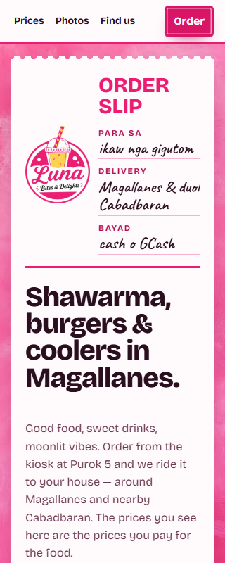

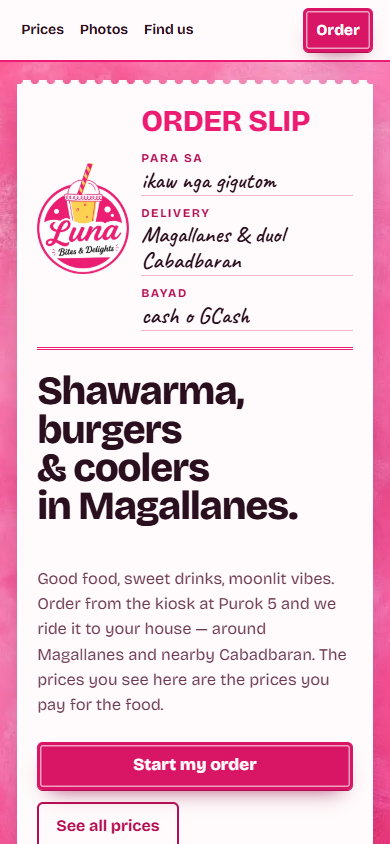

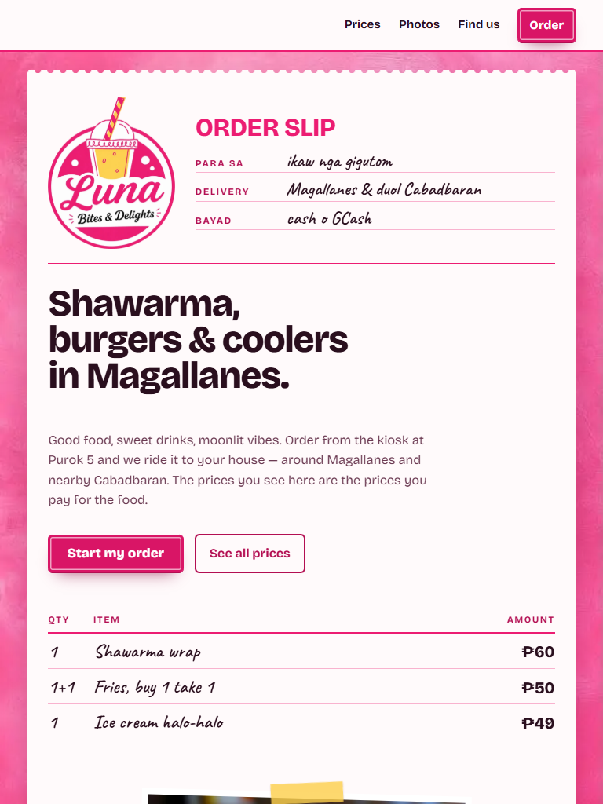

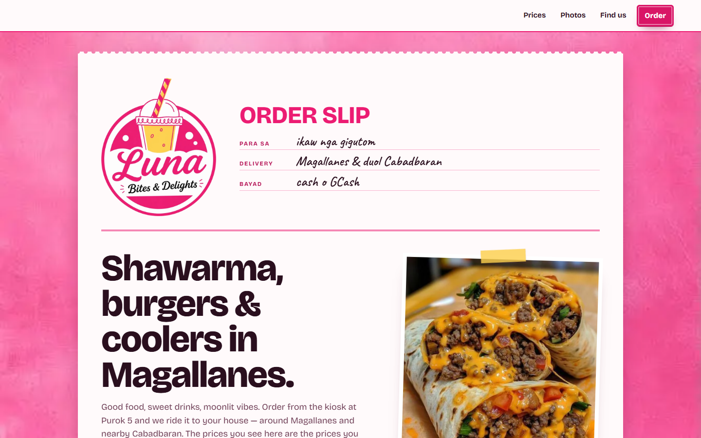

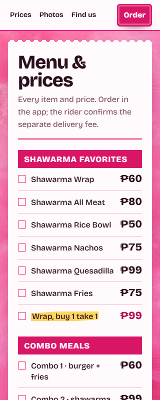

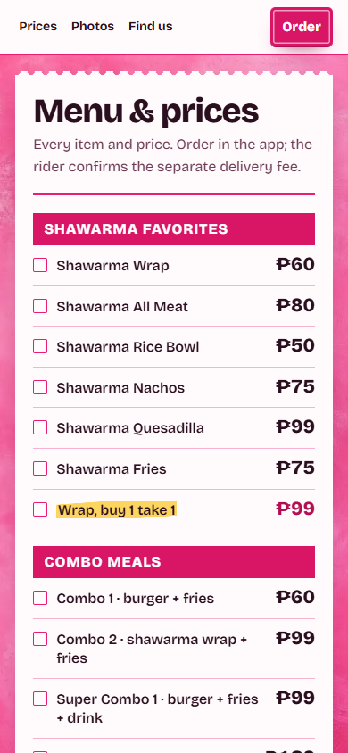

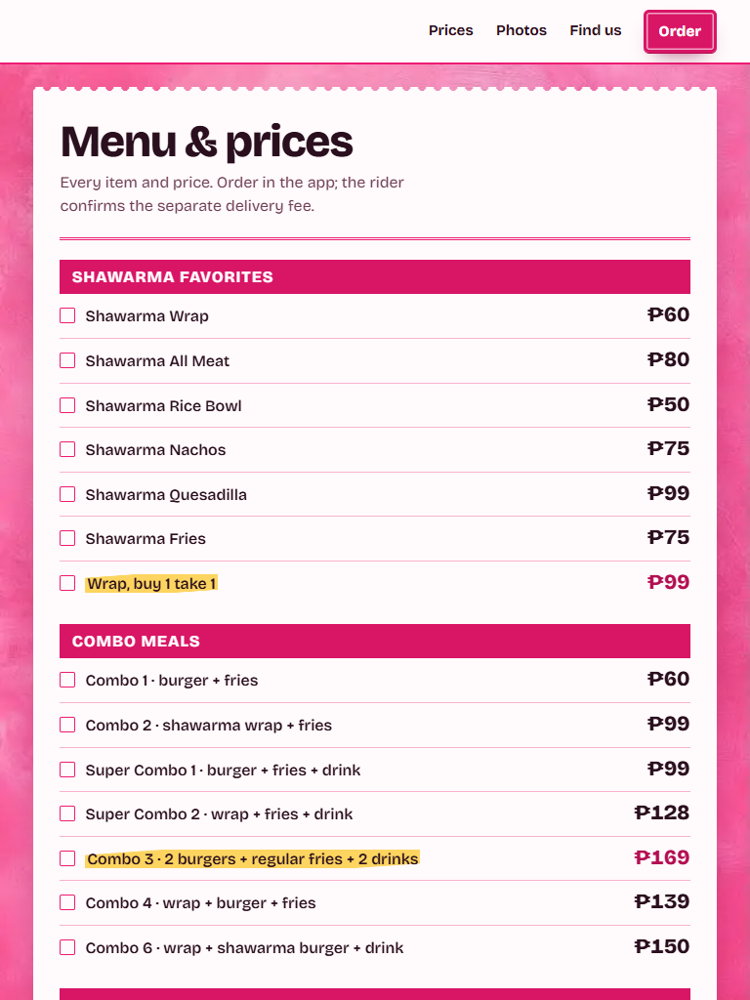

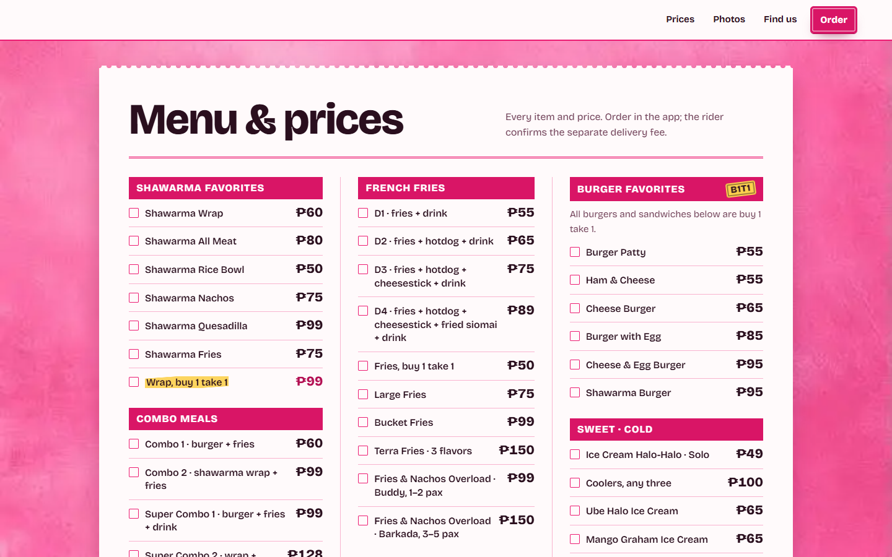

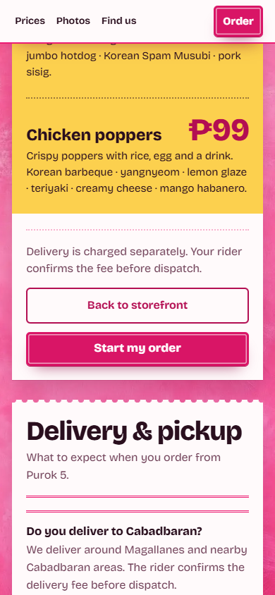

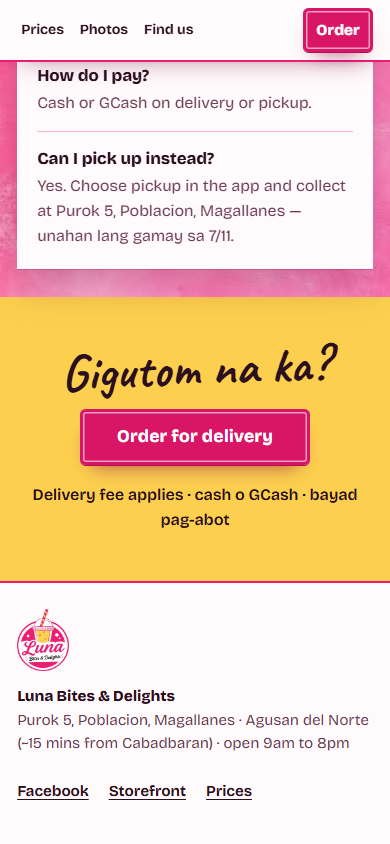

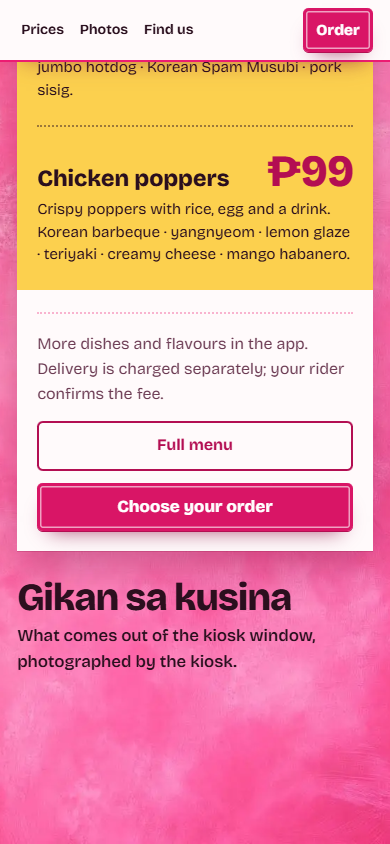

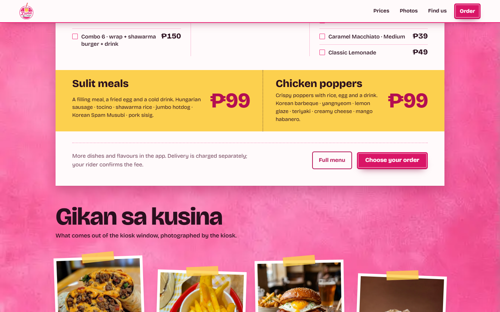

---

## Remaining blockers

1. **Phone number.** Not added. `PRODUCT.md` and the surface brief say the owner has not supplied one and forbid inventing it. Once supplied, add it to the footer, Find Us, JSON-LD `telephone`, Facebook, and the Google Business Profile.
2. **Google Business Profile.** Owner action. Create and verify the listing at Purok 5, Poblacion, Magallanes; add the phone, hours, menu URL, photos, service area, and delivery attributes.
3. **Reviews and citations.** Owner action. Ask for Google reviews and add Apple Maps, Bing Places, Waze, TripAdvisor, and Yelp listings once the phone exists.
4. **Search Console.** Verify the canonical host and submit the updated sitemap.
5. **Caching.** Still `no-cache, no-store` on every static asset. Separate P2; needs hashed filenames or a deliberate cache policy.
6. **Kiosk performance.** Unchanged at 62 mobile Lighthouse with 2,980 ms total blocking time.

---

## Files changed

- `site/index.html` — title, description, H1, JSON-LD, Open Graph, menu link, footer link.
- `site/menu/index.html` — new menu page with Menu and FAQ schema.
- `site/styles.css` — FAQ styles, menu footer actions, mobile action order.
- `site/sitemap.xml` — menu URL, updated `lastmod`, fragment removed.
- `site/llms.txt` — menu page URL and section.
- `web/index.html` — kiosk canonical, `noindex, follow`, Open Graph.
- `firebase.json` — `/menu{,/**}` rewrite.
- `docs/evidence/seo-fixes-2026-11/` — this report, screenshots, Lighthouse JSON, schema validation, hosting emulator output.
