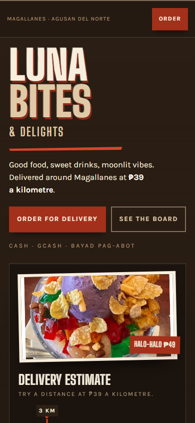
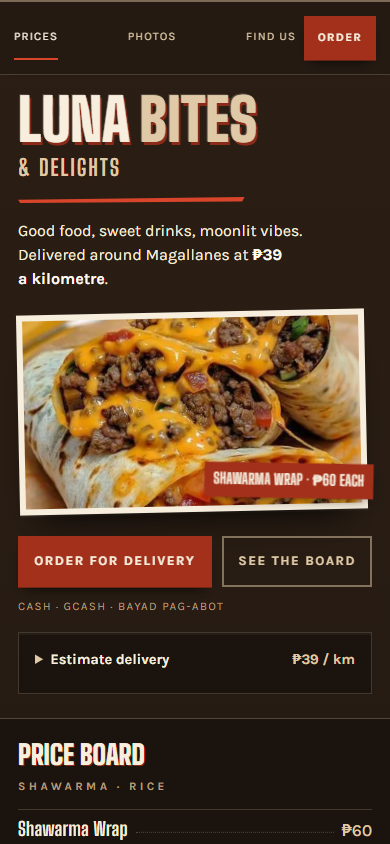
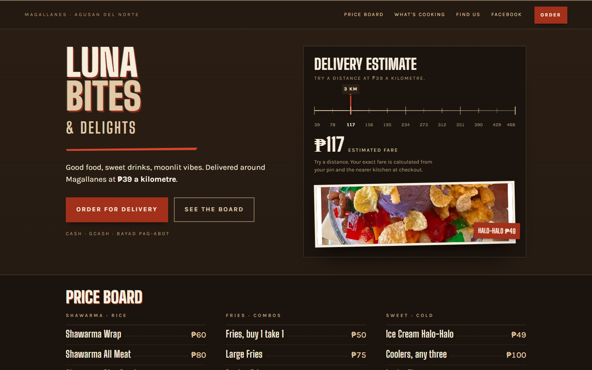
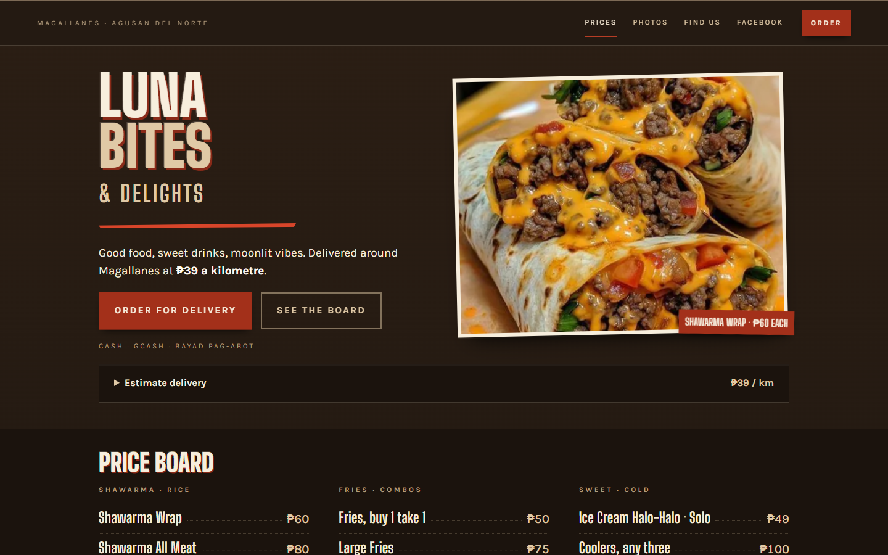

# Storefront first pass

The opening screen now shows shawarma with its per-item price before the ordering actions. The delivery calculator starts collapsed behind a native disclosure with the rate visible. Phone visitors retain Prices, Photos and Find us links in the sticky header. Starting prices name the Solo halo-halo and Medium caramel macchiato variants; the burger-with-egg photo tag names the buy-one-take-one offer.

AGENTS.md requires the Impeccable skill for all UI work in both the storefront and Flutter app. DESIGN.md and the storefront surface brief describe the updated composition.

## Before and after

Captured from the actual local storefront source in Chrome. The preview serves static files only; it has no assembled Flutter app or live checkout.

| View | Before | After |
|---|---|---|
| 390 × 844 |  |  |
| 1440 × 900 |  |  |

Additional captures: [320px phone](storefront-first-pass-after-320.png), [expanded delivery estimate at 320px](storefront-first-pass-delivery-320.png).

At 390px, the mounted food photograph starts around y308 and the price board around y718, compared with approximately y541 and y1061 before. The food, per-item price and primary order action fit in the opening 390 × 844 viewport. At 320 × 740, the order action remains in the opening viewport and the two hero actions stack.

## Verification

- Chrome at widths 320, 360, 390, 768, 940, 1024 and 1440px: no document overflow or visible content outside the viewport, with the estimate both closed and open. All visible section links have at least 44px height. All rendered food images load.
- Keyboard: Enter opens and closes the native delivery disclosure. The closed slider leaves the tab sequence. Home, End, all four arrows, Page Up and Page Down preserve synchronized distance, peso amount and ARIA values, including endpoint clamping. Focus remains visible.
- Navigation: the Prices link positions the board at y96 beneath the 73px sticky header. All five ordering links still target `/kiosk/#/menu`.
- Price qualifiers checked against `lib/data/menu_data.dart`: Solo halo-halo ₱49, Medium caramel macchiato ₱39, burger with egg ₱85 with `isBuy1Take1: true`. No price or delivery calculation changed.
- `flutter analyze --no-fatal-infos --no-fatal-warnings`: passed, with 135 existing informational findings and no warnings or errors.
- `flutter test`: all 22 tests passed.
- `cd functions && npm ci`: passed using the existing lockfile.
- `cd functions && npm run build && npm audit --audit-level=high`: passed. Audit reports 15 moderate vulnerabilities and no high or critical vulnerabilities. Local Node 24 differs from the declared Node 20 engine; build and audit still exit 0.
- `git diff --check`: passed.
- `impeccable detect --json site/index.html`: three `cramped-padding` warnings, matching the prior review. Browser computed padding at 320px is 22/18/26/18px for `.board`, 48/18/44/18px for `.find`, and 18/20/18/20px for `.find__board`; the warnings are false positives from the static scan.

## Scope and safety

Only storefront presentation and agent/design documentation change. Browser execution confirms the ordering destinations and delivery arithmetic remain intact. Flutter application files, Functions, routing, hosting configuration, prices, and security rules are unchanged. No live order was submitted, and no production deployment was performed.

Cart persistence, customer-specific inactivity behavior, category deep links, and versioned asset caching remain separate follow-ups.
